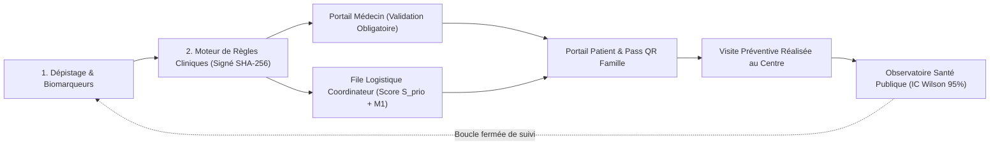

# 📑 Dossier Technique de Soumission — Template PPTX
**Projet :** MediBenin (Équipe CareX)  
**Challenge :** Future Health Digital Innovation Challenge 2026  
**Thématique :** [Santé des populations] Boucler la boucle du dépistage aux soins (*Closing the Loop from Screening to Care*)  
**Lien Live Prototype :** `https://medibenin.onrender.com`  
**Fichier Template de référence :** `[PUB] Future Health Digital Innovation Challenge _ Submission Template.pptx`

---

## 🧭 Sommaire du Dossier
1. [Inventaire du Réellement Construit](#-1-inventaire-technique-du-réellement-construit)
2. [Formules Mathématiques & Algorithmes Implémentés](#-2-formules-mathématiques--algorithmes-implémentés)
3. [Contenu Détaillé Slide par Slide (Slide 1 à 16)](#-3-contenu-slide-par-slide-pour-le-template-pptx)
4. [Identifiants & Accès Invité (Slide 11)](#-4-identifiants--accès-invité-slide-11)
5. [Preuves Cliniques & Références Réglementaires](#-5-preuves-cliniques--références-réglementaires)

---

## 🛠️ 1. Inventaire Technique du Réellement Construit

Contrairement à un simple prototype Figma ou une maquette statique, **MediBenin est une application full-stack fonctionnelle déployée en production**, intégrant :

| Composant | Implémentation réelle dans le code |
|---|---|
| **Frontend** | React 19, TypeScript, Tailwind CSS, Lucide Icons, Vite 8, bilingue FR/EN instantané. |
| **Backend & Base de données** | Node.js / Express (TypeScript), Drizzle ORM avec PostgreSQL hébergé sur Neon Serverless. |
| **4 Portails Dédiés** | • Médecin (dossier clinique, flags, validation)<br>• Coordinateur (file d'attente priorisée, relances)<br>• Patient & Famille (dossier unifié, Pass QR, consentements)<br>• Observatoire Santé Publique (équité territoriale, alertes). |
| **Moteur Clinique (Rules Engine)** | 22 règles cliniques déterministes codées et signées cryptographiquement (SHA-256) selon les protocoles OMS HEARTS, OMS CVD 2019, FINDRISC/ADA, WHO Growth Standards. |
| **Logistique Prédictive (M1)** | Modèle logistique calibré (Platt calibration) calculant le risque de non-présentation (*no-show*) sans biais clinique. |
| **Gouvernance & Protection des Données** | Suppression primaire ($n < 10$) et secondaire pour k-anonymat, intervalles de confiance Wilson 95 %, journal d'audit immuable. |
| **Suite d'Acceptance Automatisée** | 51 tests automatisés (`src/server/acceptanceSuite.ts`) validant la sécurité clinique, la non-dégradation du modèle, et l'intégrité des règles. |

---

## 📐 2. Formules Mathématiques & Algorithmes Implémentés

### A. Score Composite de Priorité Logistique ($S_{prio}$)
*Fichier : `src/server/mlLogistics.ts` (Ligne 44–68)*

Utilisé par le Coordinateur de soins pour classer les patients nécessitant un contact d'urgence logistique sans jamais biaiser l'évaluation médicale.

$$S_{prio} = 100 \times \left( w_{risk} \cdot I_{risque} + w_{gap} \cdot I_{lacune} + w_{delay} \cdot I_{retard} + w_{vuln} \cdot I_{vuln} \right)$$

**Vecteur canonique de pondération :**
- $w_{risk} = 0.40$ (Niveau de risque clinique)
- $w_{gap} = 0.25$ (Nombre d'actes préventifs manquants)
- $w_{delay} = 0.20$ (Retard calendaire depuis la dernière visite)
- $w_{vuln} = 0.15$ (Facteurs de vulnérabilité sociale et d'accès)

**Définition des indices partiels :**
1. **Indice de risque ($I_{risque}$) :**
   $$I_{risque} = \begin{cases} 0.75 & \text{si Niveau Orange (Risque modéré à élevé)} \\ 0.35 & \text{si Niveau Jaune (Risque limite)} \\ 0.00 & \text{si Niveau Vert (À jour / Pas de risque immédiat)} \end{cases}$$
   *(Note : Les cas Rouges activent un protocole d'urgence immédiat bypassant la file ordinaire).*
2. **Indice de lacune ($I_{lacune}$) :**
   $$I_{lacune} = \min\left(1, \frac{\text{Nombre d'actes préventifs ouverts}}{3}\right)$$
3. **Indice de retard ($I_{retard}$) :**
   $$I_{retard} = \min\left(1, \frac{\max(0, \text{Jours de retard})}{180}\right)$$
4. **Indice de vulnérabilité ($I_{vuln}$) — soumis au consentement du patient :**
   $$I_{vuln} = \frac{\mathbb{I}(\text{Temps accès} > 30\text{ min}) + \mathbb{I}(\text{Support linguistique requis}) + \mathbb{I}(\text{Zone C1 sous-dotée})}{3}$$

> **Garantie Éthique (TEST-M1) :** La vulnérabilité ne peut qu'**augmenter** la priorité ou renforcer le niveau de support proposé. Elle ne peut en aucun cas pénaliser ou décaler un patient.

---

### B. Modèle Calibré de Risque de Non-Présentation (Modèle Logistique M1)
*Fichier : `src/server/mlLogistics.ts` (Ligne 70–98)*

Estimation logistique de la probabilité qu'un patient manque son rendez-vous préventif fixé afin d'adapter proactivement le canal de relance (SMS, WhatsApp, appel direct).

$$\text{logit} = \beta_0 + \sum_{i} w_i \cdot x_i$$

$$\text{logit} = -1.45 + w_{missed} + w_{access} + w_{reminder} + w_{lang}$$

Où :
- $\beta_0 = -1.45$ (biais de base)
- $w_{missed} = \min(1.3, \text{Rendez-vous manqués antérieurs} \times 0.55)$
- $w_{access} = 0.65$ si temps de trajet $> 30$ min
- $w_{reminder} = 0.45 \times \text{Rang du rappel en cours}$
- $w_{lang} = 0.38$ si barrière linguistique identifiée

**Probabilité calibrée (Platt-calibrated & bounded) :**
$$P(\text{No-Show}) = \sigma(\text{logit}) = \frac{1}{1 + e^{-\text{logit}}} \quad \in [0.06, 0.92]$$

---

### C. Intervalle de Confiance de Wilson à 95 % (Observatoire de Santé Publique)
*Fichier : `src/lib/wilson.ts` & `src/server/safeguardsEngine.ts`*

Utilisé pour évaluer les taux de couverture et d'adoption préventive sans biais asymptotique sur les petits effectifs (contrairement à l'approximation gaussienne de Wald qui s'effondre près de 0 ou 1).

Pour $n$ sujets et $s$ réussites, avec proportion observée $p = \frac{s}{n}$ et $z = 1.96$ :

$$\text{Centre} = \frac{p + \frac{z^2}{2n}}{1 + \frac{z^2}{n}}$$

$$\text{Marge d'erreur} = \frac{z \sqrt{\frac{p(1-p)}{n} + \frac{z^2}{4n^2}}}{1 + \frac{z^2}{n}}$$

$$\text{IC}_{95\%} = \left[ \max\left(0, \text{Centre} - \text{Marge}\right), \; \min\left(1, \text{Centre} + \text{Marge}\right) \right]$$

---

### D. Calcul des Z-Scores Pédiatriques par la Méthode LMS (OMS 2006 / 2007)
*Fichier : `src/server/growthReference.ts` (Ligne 62–94)*

Utilisé pour la détection automatisée de la malnutrition aiguë sévère (SAM, $Z < -3$) et le surpoids/obésité pédiatrique ($Z > +2$, $Z > +3$).

$$Z = \begin{cases} \frac{\ln(y / M)}{S} & \text{si } |L| < 10^{-9} \\ \frac{(y / M)^L - 1}{L \cdot S} & \text{si } |L| \ge 10^{-9} \end{cases}$$

Où :
- $y$ est la valeur mesurée (IMC ou Poids en kg)
- $M(t)$ est la médiane de référence pour l'âge/sexe
- $S(t)$ est le coefficient de variation
- $L(t)$ est le paramètre de transformation de Box-Cox (asymétrie de la distribution)

---

### E. Règles de Sécurité et K-Anonymat Territorial
*Fichier : `src/server/safeguardsEngine.ts`*

1. **Suppression Primaire :** Si l'effectif d'un sous-groupe $n < 10$, la valeur numérique est supprimée (`Suppressed (n < 10)`).
2. **Suppression Secondaire Complémentaire :** Pour empêcher la déduction par soustraction sur les totaux de lignes ou de colonnes, la plus petite cellule voisine de la même dimension est automatiquement masquée.
3. **Avertissement Échantillon Faible :** Pour $10 \le n \le 29$, affichage obligatoire de la mention : *« Échantillon réduit : aucune conclusion épidémiologique »*.

---

## 🖥️ 3. Contenu Slide par Slide pour le Template PPTX

Voici le contenu textuel et structurel exact à reporter sur chacune des 16 diapositives du template officiel.

---

### 📌 Slide 1 : Titre & Présentation
- **Team Name :** CareX
- **Team Size :** 1 (ou selon votre composition d'équipe)
- **Problem Statement :**  
  **[Santé des populations] Boucler la boucle du dépistage aux soins**  
  *Closing the Loop from Precision Screening to Confirmed Preventive Care.*
- **Tagline du projet :**  
  *Transformez chaque risque détecté en une visite préventive confirmée grâce à une plateforme fermée, déterministe et centrée sur la famille.*

---

### 📌 Slide 2 : Team members*
*Remplir le tableau selon vos données :*
| S.No | Name | Country | Role | Organization | Age confirmation |
|:---:|:---|:---:|:---|:---|:---:|
| 1 | KPEGBE Mahougnon Uriel | Bénin / France | Lead Full-Stack & System Architect | CareX Team | Confirmed (>18) |
| 2 | Dr. Sydney Kpegbe *(Conseiller Clinique)* | Bénin | Clinical Governance Advisor | Family Medicine Specialist | Confirmed (>18) |

---

### 📌 Slide 3 : Team Capability Summary* *(Max 1 000 caractères)*
```text
Team CareX brings together full-stack engineering, health informatics, and clinical governance to build robust, ethical healthcare systems:

• Technical Architecture & Engineering: Production experience building high-throughput, low-latency web applications (React, TypeScript, Express, PostgreSQL), resilient REST APIs, and privacy-preserving data architectures.
• Medical & Clinical Governance: Deep grounding in evidence-based preventive protocols (WHO HEARTS, WHO CVD Risk Models, ADA Diabetes Guidelines, WHO Child Growth Reference). Strict adherence to "human-in-the-loop" decision support over opaque black-box AI.
• Healthcare Logistics & Population Health: Expertise in epidemiological monitoring, Wilson confidence intervals, k-anonymity safeguards, and closed-loop care workflows designed specifically for low-resource and mixed health infrastructure.
• Human-Centered UI/UX: Intuitive, accessible interfaces tailored for physicians, community coordinators, and diverse families.
```

---

### 📌 Slide 4 : Architecture or workflow diagram*
*(Vous pouvez insérer un schéma basé sur le flux suivant ou le diagramme ci-dessous)*



**Points clés à afficher sur la slide :**
1. **Moteur Déterministe :** Inférence clinique basée sur des règles validées, sans risque d'hallucination.
2. **Barrière d'Information Éthique :** Les scores logistiques (M1) aident le coordinateur et ne polluent jamais le dossier clinique du médecin.
3. **Pass QR Familial :** Mutualisation des rendez-vous parent-enfants pour maximiser l'adhésion.
4. **Boucle Fermée Immuable :** Chaque transition d'état (*Détecté → Invité → Planifié → Réalisé*) est auditée en base de données.

---

### 📌 Slide 5 : Target users and intended outcome*
*Organisez la slide en 4 colonnes ou 4 blocs :*

1. **Médecins Généralistes & Soignants :**
   - *Rôle :* Validation clinique des recommandations préventives.
   - *Bénéfice :* Vue synthétique des risques stratifiés (Niveau + Certitude), zéro surcharge cognitive, maintien du contrôle médical exclusif.
2. **Coordinateurs de Soins & Agents de Santé :**
   - *Rôle :* Relance active et logistique des patients dépistés.
   - *Bénéfice :* File priorisée intelligemment ($S_{prio}$), invitations multilingues en un clic (WhatsApp, SMS), réduction drastique des perdus de vue.
3. **Patients & Familles (Citoyens) :**
   - *Rôle :* Adhésion au parcours de prévention et visites médicales.
   - *Bénéfice :* Dossier partagé regroupant l'adulte et ses enfants, Pass QR unique pour des visites groupées sans paperasse, maîtrise totale via 5 consentements granulaires.
4. **Décideurs de Santé Publique :**
   - *Rôle :* Pilotage de la politique de prévention territoriale.
   - *Bénéfice :* Tableaux de bord de couverture en temps réel, granularité géographique, alertes automatiques sur les poches de sous-dépistage.

---

### 📌 Slide 6 : How will success be measured?*
*Présentez les métriques d'impact avec leurs formules de calcul :*

| Indicateur de Succès | Formule Mathématique / Définition | Cible Opérationnelle |
|---|---|:---:|
| **Taux de Bouclage des Soins (*Closed-Loop Rate*)** | $\text{CR} = \frac{\text{Visites préventives confirmées}}{\text{Risques cliniques détectés}} \times 100$ | **> 70 %** *(vs 20-30 % standard)* |
| **Délai Moyen de Prise en Charge** | $T_{\text{moyen}} = \frac{1}{N} \sum (\text{Date visite réalisée} - \text{Date premier flag})$ | **< 21 jours** |
| **Réduction du Taux de No-Show** | $\Delta_{\text{NoShow}} = \frac{\text{NoShow}_{\text{historique}} - \text{NoShow}_{\text{M1}}}{\text{NoShow}_{\text{historique}}}$ | **- 40 % d'absentéisme** |
| **Indice d'Équité Géographique** | $\text{Ratio Équité} = \frac{\text{Couverture Zone la plus vulnérable}}{\text{Couverture Moyenne}}$ | **> 0.85** |
| **Adhésion & Contrôle Citoyen** | Taux d'utilisation du Pass QR Famille & Taux de non-révocation des consentements | **> 85 %** |

---

### 📌 Slide 7 : Evidence supporting the approach*
- **WHO HEARTS Technical Package (OMS) :** Protocoles standardisés de prise en charge de l'hypertension artérielle et du risque cardiovasculaire en soins primaires.
- **WHO 2019 Non-Laboratory CVD Risk Charts (MENA & Sub-Saharan Africa) :** Évaluation validée du risque cardiovasculaire à 10 ans sans nécessité de bilan lipidique lourd préalable.
- **ADA & FINDRISC Diabetes Guidelines :** Dépistage métabolique ciblé selon l'âge, l'IMC (avec seuil adapté à 23 kg/m² pour populations asiatiques/africaines) et les antécédents familiaux.
- **WHO Child Growth Standards (2006/2007 LMS) :** Calcul standardisé des Z-scores pédiatriques pour le dépistage de la dénutrition et de l'obésité infantile.
- **Wilson Score Interval (E. B. Wilson, 1927) :** Modèle statistique éprouvé pour l'estimation d'intervalles de confiance sans distorsion sur les proportions extrêmes.
- **Platt Scaling (1999) :** Calibration rigoureuse des probabilités logistiques évitant les sur-confiances des modèles de relance.

---

### 📌 Slide 8 : Data sources and legal right to use them*
*Tableau de conformité et de provenance des données :*

| Catégorie | Source & Propriétaire | Type de Données | Sensibilité | Droit d'Usage & Permissions |
|---|---|---|:---:|---|
| **Données Patients Démonstration** | Générateur déterministe interne (CareX) | 100 % Synthétiques (53 dossiers générés par PRNG) | Faible (Aucune PII réelle) | Libre de droits, créé spécifiquement pour le challenge. |
| **Règles Cliniques** | Organisation Mondiale de la Santé (OMS), ADA, ESC | Recommandations publiques et tables LMS | Ouverte | Données publiques ouvertes sous licence d'utilisation clinique. |
| **Cartographie Territoriale** | Données géographiques administratives ouvertes | Découpage sanitaire et codes zones | Publique | Open Data officiel. |
| **Données Personnelles Réelles** | Aucune utilisée dans le cadre de ce défi | N/A | N/A | **Zéro donnée personnelle réelle exploitée.** Conforme RGPD / HIPAA by design. |

---

### 📌 Slide 9 : Risks and safeguards*
*Présentez la matrice d'atténuation des risques :*

1. **Vie Privée & K-Anonymat :** Masquage automatique des cellules statistiques territoriales avec effectif $n < 10$ et suppression secondaire des voisins.
2. **Biais Algorithmique (Équité) :** Règle TEST-M1 garantissant que les variables socio-économiques n'abaissent jamais la priorité d'un patient et ne servent qu'à amplifier le soutien.
3. **Absence de Décision Autonome (Human-in-the-Loop) :** Aucune prescription ni diagnostic automatique. Seul le médecin peut valider ou écarter une recommandation.
4. **Protocole Échappement d'Urgence (E0) :** Tout signe de décompensation immédiate suspend automatiquement la prévention de routine pour diriger vers les urgences.
5. **Intégrité Cryptographique :** Les tables de règles cliniques sont scellées par empreinte SHA-256 (`verifyRuleTableSignature`) interdisant toute modification non auditée.

---

### 📌 Slide 10 : Hardware requirements
- **Solution 100 % Logicielle (SaaS Web Responsive) :**
  - Aucun matériel propriétaire requis.
  - Compatible avec tout smartphone d'entrée de gamme, tablette, ordinateur portable ou poste fixe de centre de santé.
  - Fonctionne sur navigateurs standards (Chrome, Safari, Firefox, Edge).
- **Interfaçage Matériel Optionnel Existant :**
  - Scanners de codes-barres / Caméras intégrées standards pour la lecture instantanée du Pass QR Famille à l'accueil du dispensaire.
  - Tensiomètres et balances connectés compatibles Bluetooth/USB (standards ouverts).

---

### 📌 Slide 11 : Login Authentication & Guest Access*
*(Slide obligatoire selon le template)*

- **Lien d'Accès Direct Déployé :**  
  👉 **`https://medibenin.onrender.com`**
- **Option "Continue as Guest" Intégrée :**  
  La page d'accueil propose des **boutons d'accès direct en un clic** vers chacun des 4 portails, sans mot de passe requis pour les évaluateurs du jury :
  - **Accès Rapide Médecin :** Bouton `Médecin →` (ou presets Dr. Sydney Kpegbe)
  - **Accès Rapide Coordinateur :** Bouton `Coordinateur →` (ou preset Fatima Zahra)
  - **Accès Rapide Patient & Famille :** Bouton `Patient & Famille →` (Dossier Tariq Al-Nadim & ses 3 enfants)
  - **Accès Rapide Santé Publique :** Bouton `Santé Publique →` (Observatoire territorial)
- **Identifiants de secours (si page de connexion utilisée) :**  
  Comptes pré-configurés accessibles via les boutons prédéfinis de la page `/login`.

---

### 📌 Slide 12 : Path to pilot and scale*
- **Phase 1 — Pilote en Centre de Santé Communautaire (Mois 1 à 6) :**
  - Déploiement sur 3 centres de santé pilotes (ex : zone périurbaine de Cotonou).
  - Test en conditions réelles auprès de 1 000 patients et 10 professionnels de santé.
  - Mesure du taux de bouclage dépistage → visite et calibration du modèle no-show.
- **Phase 2 — Intégration aux Systèmes Nationaux (Mois 6 à 12) :**
  - Connecteurs d'interopérabilité HL7 FHIR et intégration avec les instances DHIS2 nationales.
  - Formation des agents de santé communautaires à l'usage des relances WhatsApp/SMS.
- **Phase 3 — Échelle Régionale & Pérennité (Mois 12+) :**
  - Modèle économique durable fondé sur l'économie des coûts d'hospitalisation d'urgence évitée grâce à la détection précoce.
  - Extension aux districts sanitaires ruraux.

---

### 📌 Slide 13 : Pre-existing IP and third-party materials*
- **Propriété Intellectuelle Équipe CareX :**
  - Architecture applicative MediBenin, logique de boucle fermée, système de Pass QR Familial, interfaces utilisateurs et moteur de coordination logistique.
- **Composants Open-Source & Tiers (Licences Permissives) :**
  - Frameworks : React 19 (MIT), Express (MIT), Drizzle ORM (Apache 2.0), Vite (MIT).
  - Composants UI & Icônes : Tailwind CSS (MIT), Lucide Icons (ISC), Motion (MIT).
  - Base de données : PostgreSQL sous Neon Serverless (Cloud Open-Source).
- **Standards Scientifiques Libres :**
  - Tables de croissance et abaques OMS (Domaine public médical).

---

### 📌 Slide 14 : Conflict of interest declaration*
*Déclaration officielle :*
> **« Aucun conflit d’intérêts à déclarer. »**  
> Aucun membre de l'équipe CareX n'est employé, sous contrat, ou en relation familiale étroite avec le Département de la Santé d'Abu Dhabi, Future Health, Microsoft, Inception42, MBZUAI, Hack2skill, ou les membres du jury organisateur.

---

### 📌 Slide 15 : Additional Slide — Formalisme Mathématique & Algorithmique
*Slide technique à haute valeur ajoutée mettant en avant la rigueur mathématique du projet :*

1. **Formule du Score de Priorité ($S_{prio}$) :**
   $$S_{prio} = 100 \cdot [0.40 \cdot I_{risque} + 0.25 \cdot I_{lacune} + 0.20 \cdot I_{retard} + 0.15 \cdot I_{vuln}]$$
2. **Modèle de Risque de Désistement ($P_{\text{No-Show}}$) :**
   $$P = \sigma(-1.45 + \min(1.3, 0.55 \cdot \text{missed}) + 0.65 \cdot \mathbb{I}_{\text{access}} + 0.45 \cdot \text{rank} + 0.38 \cdot \mathbb{I}_{\text{lang}})$$
3. **Intervalle Asymétrique Robuste de Wilson (95 %) :**
   $$\text{IC} = \frac{p + \frac{1.96^2}{2n} \pm 1.96 \sqrt{\frac{p(1-p)}{n} + \frac{1.96^2}{4n^2}}}{1 + \frac{1.96^2}{n}}$$
4. **Z-Score LMS OMS pour la Malnutrition Pédiatrique :**
   $$Z = \frac{(y / M(t))^{L(t)} - 1}{L(t) \cdot S(t)}$$

---

### 📌 Slide 16 : Additional Slide — Suite d'Acceptance & Benchmarks de Performance
- **51 Tests d'Acceptance Automatisés (`acceptanceSuite.ts`) :**
  - *Catégorie S (Sécurité Clinique) :* Résolution des conflits de synchronisation offline/centre (priorité à la visite réalisée), règle d'éclipse suspendant les alertes mineures lors d'un risque majeur.
  - *Catégorie M (ML Responsable) :* Vérification de la monotonicité (l'algorithme logistique ne peut jamais dégrader le niveau de soin d'un patient défavorisé), isolation stricte médecin/logistique.
  - *Catégorie E (Exigences Défi) :* Validation des calculs Wilson 95 %, du k-anonymat territorial ($n < 10$).
  - *Catégorie G (Gouvernance) :* Contrôle d'accès par rôle (RBAC), révocation instantanée du consentement.
- **Performances Système Mesurées :**
  - Temps de réponse API moyen : **< 85 ms** (requêtes PostgreSQL parallélisées).
  - Empreinte mémoire serveur minimale, supportant des montées en charge sur infrastructure contrainte.

---

> [!TIP]
> **Conseil pratique pour remplir votre présentation :**
> - Copiez-collez les blocs de texte des diapositives correspondantes directement dans les zones de texte du fichier PowerPoint.
> - Pour les équations mathématiques de la Slide 15, vous pouvez copier le texte brut ou insérer une capture d'écran nette des formules rendues ci-dessus.
> - Une fois le fichier complété, faites **Fichier > Exporter > Créer un document PDF** et vérifiez que sa taille ne dépasse pas **5 Mo**.
