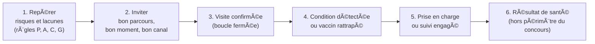
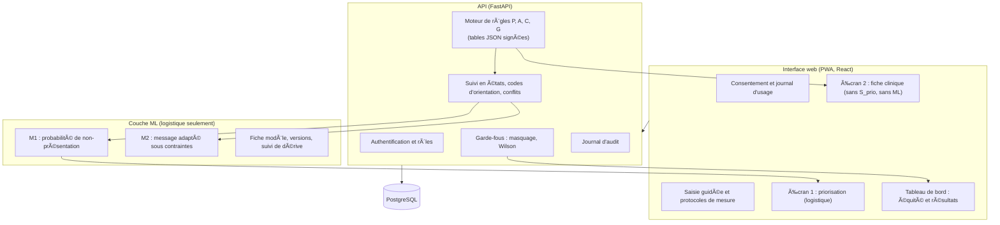

# MediBenin — Addendum v8.0 : alignement sur les critères d'évaluation

**Addendum à la v7.0 du cahier des charges · Challenge 04 : Precision Prevention and Screening**

| | |
| :--- | :--- |
| **Version** | 8.0 (addendum à la v7.0), 10 novembre 2026 |
| **Équipe** | CareX (Université d'Abomey-Calavi : ENEAM, IFRI, FSS) |
| **Source des critères** | Page officielle du défi (Hack2skill), consultée le 10 novembre 2026. Les six critères sont listés avec la mention « Impact first. Then proof that it works. ». **Les pondérations ne sont pas publiées.** |
| **Non vérifié** | Les réponses de la FAQ et la page des règles complètes n'ont pas pu être lues : voir V16 et V17 (section 26) |
| **Convention** | Mêmes marquages que la v7.0 : fait sourcé, hypothèse (H), **[À VÉRIFIER]**, **[SIMULÉ]** |

> [!IMPORTANT]
> **Ce que cet addendum change dans la stratégie.** La v7.0 est très forte sur la gouvernance et la pertinence clinique, mais trois critères restent insuffisamment servis : la **profondeur technique** (le moteur est 100 % règles), la **solution fonctionnelle** (périmètre trop large pour 10 jours) et la **viabilité commerciale** (aucun acheteur ni modèle économique testé). L'évaluation se fait **sur dossier, sans l'équipe** (le jury désigne les trois finalistes uniquement sur évaluation, avant GITEX) : tout doit être compréhensible et vérifiable à partir du dépôt, de la démo hébergée et de la vidéo.

---

## Instructions d'intégration à la v7.0

| Section v7.0 | Modification à faire |
| :--- | :--- |
| 0. Lecture rapide | Ajouter la phrase de positionnement (17.1) et remplacer « ce que le jury verra » par la liste du 20.1 |
| 2.3 Statut des briques | Ajouter les lignes M1 et M2 (19.3, 19.4) avec le statut « Réel (données synthétiques) » |
| 9.1 Architecture | Remplacer le schéma par celui du 19.2 (couche ML) ; appliquer AD-1 (application web unique) |
| 11.1, 11.2, 11.4 | Remplacées par les sections 24.1 à 24.3 et 20.2 |
| 13 Modèle économique | Complétée par la section 23 |
| 14 Matrice des risques | Ajouter le registre des dangers D1 à D12 (21.1) |
| 15 Hypothèses et vérifications | Ajouter H17 à H24 et V16 à V20 (section 26) |
| Nouvelle section | Insérer les sections 17 à 26 après la section 16 |

---

## 17. Alignement sur les critères d'évaluation

### 17.1 Positionnement en une phrase

**FR :** MediBenin ne remplace pas le jugement clinique : il ferme la boucle entre un risque repéré et une visite réellement faite, avec des règles publiques, une incertitude visible et des garde-fous d'équité mesurés.

**EN:** MediBenin does not replace clinical judgement: it closes the loop between an identified risk and a completed visit, using published rules, visible uncertainty and measured equity safeguards.

### 17.2 Matrice critère par critère

| # | Critère officiel | Ce que le jury cherche (notre lecture) | Notre réponse | Preuve visible dans le dépôt ou la démo | Sections |
| :---: | :--- | :--- | :--- | :--- | :---: |
| 1 | **Health impact and clinical relevance** | Un problème de santé réel, une chaîne causale crédible jusqu'au bénéfice, des règles défendables cliniquement | Théorie du changement en 6 maillons, mesure à chaque maillon, règles traçables jusqu'à une directive et signées par un clinicien | Schéma de la chaîne ; fiche d'un signalement avec règle et source ; modèle d'impact | 18, 4, 8 |
| 2 | **Technical depth and architecture** | Une architecture réfléchie, des choix justifiés, de l'IA ou du ML bien placé, de la qualité d'ingénierie | Règles pour le clinique, **ML pour le logistique** (prédiction de non-présentation, message adapté sous contrainte), décisions d'architecture documentées, tests, reproductibilité | Dépôt avec tests ; fiche modèle ; schéma d'architecture ; résultats d'évaluation ML | 19, 9 |
| 3 | **Working solution and demonstration quality** | Un prototype qui tourne, une démo claire, qui marche sans l'équipe | Application web hébergée, trois personas préchargés, vidéo de 5 minutes, README de démarrage en moins de 5 minutes | Lien de démo, vidéo, rapport de tests | 20, 24 |
| 4 | **Responsible AI, safety and data governance** | Supervision humaine, gestion des dangers, équité, vie privée, transparence sur l'IA | Registre des dangers, matrice de supervision humaine, gouvernance des données, tests d'équité, divulgation de l'usage de l'IA | Registre D1–D12, fiche modèle, journal d'usage des données | 21, 3, 7 |
| 5 | **Scalability and deployment readiness** | Une route crédible du prototype à un déploiement réel | Paliers prototype, pilote, programme, autre pays ; modèle de capacité ; mode « ombre » ; checklist de préparation | Tableau des paliers, checklist avec statuts | 22 |
| 6 | **Commercial viability and path to pilot** | Un acheteur identifié, une valeur mesurable, un chemin concret jusqu'au pilote | Panorama de l'existant, économie unitaire, pilote en 4 phases dont une phase « ombre », questions à valider avec un acheteur | Tableau comparatif, plan de pilote avec critères de passage fixés à l'avance | 23, 13 |

### 17.3 Autoévaluation qualitative (estimation interne, pas une prédiction de note)

| Critère | État v7.0 | Cible v8.0 | Condition pour l'atteindre |
| :--- | :---: | :---: | :--- |
| 1. Impact et pertinence clinique | Fort | Fort | Ajout de la théorie du changement et du modèle d'impact |
| 2. Profondeur technique | Moyen | Fort | **M1 et M2 livrés et évalués**, décisions d'architecture documentées |
| 3. Solution fonctionnelle | Moyen | Fort | **Périmètre v8 tenu**, déploiement hébergé, vidéo |
| 4. IA responsable | Fort | Fort | Registre des dangers et fiche modèle livrés |
| 5. Échelle et déploiement | Moyen | Moyen à Fort | Modèle de capacité, mode « ombre », checklist |
| 6. Viabilité commerciale | Fragile | Moyen | Aucun acheteur n'est validé : on présente un cadre et un plan, **sans prétendre à une demande prouvée** |

---

## 18. Critère 1 : impact en santé et pertinence clinique

### 18.1 Théorie du changement

La valeur de MediBenin se situe aux maillons **2 et 3**, là où les programmes existants perdent le plus de personnes entre l'alerte et la visite effective **(H17 de départ : à confirmer avec le partenaire)**.

### 18.2 Ce qu'on mesure à chaque maillon, et où

| Maillon | Indicateur | Mesuré dans le prototype | Mesuré dans le pilote | Au-delà |
| :---: | :--- | :---: | :---: | :---: |
| 1 | Portée, taux de recommandation, part de Niveau Gris, erreurs par segment | Oui (synthétique) | Oui | |
| 2 | Part des invitations validées et envoyées dans le délai du niveau | Oui (simulé) | Oui | |
| 3 | Adoption = visites confirmées / invités ; ponctualité | Oui (synthétique) | Oui | |
| 4 | Rendement : conditions confirmées pour 100 invitations ; doses rattrapées | Oui (synthétique) | Oui | |
| 5 | Suivi engagé après un résultat positif | | Oui | |
| 6 | Morbidité, mortalité, coûts évités | | | **Non revendiqué** |

### 18.3 Modèle d'impact (formules, sans chiffres inventés)

$$\text{Visites supplémentaires confirmées} = N_{\text{invités}} \times \left(a_{\text{MediBenin}} - a_{\text{référence}}\right)$$

$$\text{Conditions supplémentaires détectées} = \text{Visites supplémentaires} \times r$$

où $a$ est le taux d'adoption (visites confirmées / invités) et $r$ le rendement par visite (conditions confirmées / visites). Les valeurs de $a_{\text{référence}}$ et de $r$ **viennent du partenaire et du pilote** ; le prototype ne les fixe pas.

**Table de sensibilité livrée avec la démo :** résultat du modèle pour une grille de valeurs de $a$ et de $r$, présentée comme un *outil de raisonnement* et non comme une prévision.

### 18.4 Pertinence clinique : ce qui rend les règles défendables

- Chaque règle cite sa directive, sa version et son statut (Publié, H ou À VÉRIFIER) : tableaux 4.2 et 4.3.
- Toute table est **signée par un clinicien diplômé** avant usage (section 12, H14). **Tant que ce clinicien n'est pas identifié, l'écrire explicitement dans le dossier.**
- Un résultat ne présente jamais un score comme un diagnostic ; le Niveau Gris et le badge « à confirmer » empêchent de rassurer à tort.
- **Ce que nous ne prétendons pas :** aucune performance clinique, aucun effet sur la santé, aucune sensibilité ni spécificité réelle (15.2).

### 18.5 Adéquation avec l'énoncé du défi

| Attente de l'énoncé | Réponse MediBenin |
| :--- | :--- |
| Passer d'une prise en charge réactive à une prévention prédictive | Repérage par règles multi-domaines plutôt que par âge et sexe seuls |
| Transformer des données longitudinales en actions concrètes | Parcours unique, échéance, rappel, suivi en états, visite confirmée |
| Exploiter les informations génomiques | Règle d'éligibilité G1 à G3 **[SIMULÉ]**, voie d'accélération familiale pour l'équité |
| Transparence sur l'usage et les autorisations des données | Consentement par finalité, journal d'usage consultable |

---

## 19. Critère 2 : profondeur technique et architecture

### 19.1 Principe directeur (décision AD-2)

> **Les règles décident du clinique ; le ML n'agit que sur le logistique.**
> Le niveau d'un signalement (Rouge, Orange, Jaune, Vert, Gris) vient uniquement de règles publiques, signées et explicables. Le ML estime des **probabilités opérationnelles** (la personne viendra-t-elle ?) pour mieux accompagner, jamais pour déclasser.

**Pourquoi ce choix.** (1) Il n'existe pas de données réelles étiquetées pour apprendre un risque clinique. (2) Un risque appris et opaque serait difficile à signer et à auditer. (3) Le défi demande de la transparence sur les facteurs de chaque signalement. En revanche, la non-présentation est un problème où l'apprentissage apporte de la valeur sans compromettre la sécurité clinique.

### 19.2 Architecture mise à jour (décision AD-1 : une application web unique)

**AD-1.** Pour tenir le délai, le prototype est **une application web responsive (PWA)** servie par FastAPI et React, qui sert à la fois d'interface de terrain et de console. L'application Flutter native passe en feuille de route (statut mis à jour en 2.3). Une démonstration hors ligne simple reste possible via le mode PWA **(Facultatif)**.

**Garde-fou architectural :** la couche ML n'a **aucun accès en écriture** au niveau d'un signalement ni à l'écran 2. Un test automatique vérifie qu'aucun champ issu du ML n'apparaît dans les réponses de l'API destinées à la fiche clinique (TEST-M2).

### 19.3 M1 : probabilité de non-présentation

| Élément | Choix |
| :--- | :--- |
| **Question** | Pour une invitation envoyée, quelle est la probabilité qu'elle n'aboutisse pas à une visite confirmée dans sa fenêtre ? |
| **Cible** | Invitation sans état « Réalisée » dans le délai du niveau |
| **Variables autorisées** | Rang de l'invitation, canal, langue, temps d'accès, créneau (jour, heure), nombre de visites manquées antérieures, type de parcours, période du Ramadan, délai déjà écoulé |
| **Variables exclues du modèle** | Nationalité, religion, génomique, état de santé détaillé. Elles ne servent **qu'à l'audit d'équité** (21.4) |
| **Modèles comparés** | (a) référence simple : taux historique par type de parcours ; (b) régression logistique ; (c) boosting d'arbres (par exemple `HistGradientBoostingClassifier`). On retient le plus simple dont les performances sont équivalentes (tolérance H18) |
| **Calibrage** | Calibrage isotonique ou de Platt ; on publie le score de Brier et l'ECE |
| **Explication** | Coefficients pour (b) ; contributions SHAP, trois facteurs affichés, pour (c) |
| **Usage autorisé** | (1) ajuster le moment et le canal du rappel ; (2) proposer un contact humain pour les Orange à forte probabilité de non-présentation (budget H19) ; (3) suggérer un surbooking agrégé au niveau du centre |
| **Usage interdit** | **Abaisser la priorité d'une personne ou retarder une invitation.** Le ML ne peut que *renforcer* l'accompagnement. Cette règle est testée (TEST-M1) |
| **Visibilité** | Écran 1 uniquement. Jamais sur la fiche clinique |
| **Statut** | Réel, entraîné et évalué sur données synthétiques **[SIMULÉ]** |

### 19.4 M2 : message adapté sous contraintes

| Élément | Choix |
| :--- | :--- |
| **Rôle** | Reformuler un **modèle de message validé par la gouvernance clinique** selon la langue, le destinataire et le registre |
| **Ce que le modèle voit** | Identifiant du modèle de message, langue, destinataire (parent, adolescent, adulte), registre. **Aucune donnée de santé ni donnée personnelle** |
| **Contrôles automatiques** | Liste d'exclusion (diagnostic, score, mention génétique), conservation des variables (`[date]`, `[lieu]`), longueur maximale, niveau de lecture, similarité avec le message validé par rétro-traduction |
| **Validation humaine** | **Toujours** avant envoi (6.5). Aucun envoi automatique |
| **Repli** | Variantes préécrites si le modèle de langage est indisponible, ou si V19 interdit son usage |
| **Statut** | Réel pour la génération et les contrôles ; envoi **[SIMULÉ]** |

### 19.5 Ce que nous avons volontairement écarté (M0 : risque clinique appris)

Un modèle qui apprendrait les lacunes de soins ou le risque à partir de données est **hors prototype**. Raisons : pas d'étiquettes réelles, risque de circularité avec nos données synthétiques, perte de transparence. Il reste en **feuille de route**, à envisager sur les données du pilote, avec une évaluation prospective et une comparaison aux règles.

### 19.6 Protocole d'évaluation du ML

| Élément | Protocole |
| :--- | :--- |
| Découpage | Par graine et par période (entraînement sur les premières périodes, test sur les suivantes) |
| Mesures | PR-AUC, score de Brier, ECE ; **écarts de TPR et de TFP entre segments** |
| Test d'utilité | À **budget de contacts humains B égal (H19)**, comparer le ciblage aléatoire, le ciblage par règle simple et le ciblage M1 sur le taux de visites confirmées |
| Scénarios dégradés | Les trois scénarios de 8.4 (données manquantes non aléatoires, sous-déclaration, historique incomplet) |
| Limite à écrire | La dynamique des non-présentations est celle de **notre générateur** (H24). Le test montre que le mécanisme fonctionne et que le gain est *possible* ; il ne prouve pas un gain réel |
| Générateur | Les facteurs de non-présentation sont documentés dans le dépôt avec leur source **[V20]** et sont distincts des variables du modèle autant que possible |

### 19.7 Fiche modèle (squelette à remplir dans le dépôt)

| Rubrique | Contenu |
| :--- | :--- |
| Identité | Nom, version, date, responsable |
| Usage prévu et interdit | 19.3 |
| Données d'entraînement | Synthétiques, graine, structure, limites |
| Performance | Mesures de 19.6, avec intervalles |
| Équité | Écarts par segment, seuils d'alerte |
| Limites connues | Dépendance au générateur, absence de données réelles |
| Surveillance | Dérive des variables, recalibrage, critères de retrait |
| Supervision humaine | Qui peut ignorer ou désactiver le modèle |

### 19.8 Qualité d'ingénierie (visible dans le dépôt)

- Tests unitaires par règle, tests d'acceptation (11.3 et section 20.5), intégration continue qui les exécute.
- Reproductibilité : une commande (`docker compose up`) lance l'application avec les personas ; la cohorte se régénère à partir d'une graine.
- Tables de règles versionnées et signées ; une table non signée est refusée (TEST-S5).
- API documentée (OpenAPI), validation des entrées, journal d'audit.
- Aucun secret ni donnée réelle dans le dépôt.

---

## 20. Critère 3 : solution fonctionnelle et qualité de la démonstration

### 20.1 Ce que l'évaluateur peut faire seul, sans nous

1. Ouvrir le lien de démo, choisir un persona, parcourir le parcours complet.
2. Passer de l'écran 1 (priorisation) à l'écran 2 (clinique) et constater que $S_{\text{prio}}$ et le ML ont disparu.
3. Voir un Niveau Gris et un badge de certitude « Faible ».
4. Refuser une recommandation et constater l'arrêt des relances.
5. Ouvrir le tableau d'équité avec une cellule masquée.
6. Lancer le banc d'essai et reproduire un résultat à partir de la graine.

### 20.2 Script de la vidéo : 5 minutes (remplace 11.2)

| Temps | Séquence | Message clé |
| :---: | :--- | :--- |
| 0:00–0:30 | Problème et phrase de positionnement | Les personnes qui en ont le plus besoin sont oubliées |
| 0:30–1:30 | Persona enfant de 18 mois : signalement, facteurs, badge, parcours unique | Transparence et incertitude visibles |
| 1:30–2:15 | Persona adulte de 36 ans : règle A4, signal génomique **[SIMULÉ]**, modèle OMS « hors domaine » | Pas de trou, pas de fausse précision |
| 2:15–3:00 | Écran 1 puis écran 2 ; M1 renforce l'accompagnement d'un Orange | Séparation population et clinique ; ML au service de l'accompagnement |
| 3:00–3:45 | Message en arabe et en anglais ; refus qui arrête les relances ; visite confirmée par code | Choix réel et boucle fermée |
| 3:45–4:30 | Tableau d'équité, masquage, comparaison à l'invitation par âge et sexe | Garde-fous et évaluation par les résultats |
| 4:30–5:00 | Limites déclarées et chemin vers le pilote | Honnêteté et maturité |

La vidéo est sous-titrée en anglais. Elle est publiée avec un lien stable et incluse dans le dépôt.

### 20.3 Hébergement et plan de secours

- Démo hébergée, accessible sans installation, avec comptes de démonstration documentés.
- **Plan B :** vidéo complète et procédure `docker compose up` testée sur une machine vierge.
- Test de la démo hébergée à froid la veille du dépôt, depuis un réseau extérieur à l'université.

### 20.4 Personas

Les trois personas de la v7.0 (11.2) sont conservés et préchargés, avec leurs cas limites (dossier incomplet, enfant prématuré, grossesse). Ils sont décrits dans le README avec le résultat attendu pour chacun.

### 20.5 Tests d'acceptation supplémentaires

| Test | Vérification |
| :--- | :--- |
| TEST-M1 | Aucune sortie de M1 ne modifie le niveau d'un signalement ni n'abaisse un rang de priorité |
| TEST-M2 | Aucun champ issu du ML n'apparaît dans les réponses de l'API de la fiche clinique |
| TEST-M3 | M2 : tout message généré conserve ses variables et échoue au contrôle s'il contient un terme de la liste d'exclusion |
| TEST-M4 | La démo démarre à froid sur une machine vierge en suivant le README (README.md fourni ; un garde-fou automatisé vérifie que chaque commande du README existe bien dans le projet) |
| TEST-M5 | Le banc d'essai reproduit les mêmes résultats avec la même graine |

---

## 21. Critère 4 : IA responsable, sécurité et gouvernance des données

### 21.1 Registre des dangers (complète la matrice 14)

| ID | Danger | Cause | Conséquence | Gravité | Mesure | Test |
| :---: | :--- | :--- | :--- | :---: | :--- | :---: |
| D1 | Faux négatif rassurant | Donnée manquante, règle trop permissive | Retard de prise en charge | Critique | Niveau Gris ; badge « à confirmer » ; contrôle de 5 % des Verts ; alerte C4 | E1 |
| D2 | Faux positif anxiogène | Seuil trop bas | Anxiété, examens inutiles | Moyenne | Aide à la décision avec limites ; message sans diagnostic ; suivi du taux | E3 |
| D3 | Message mal traduit ou ambigu | Traduction, reformulation M2 | Incompréhension, refus | Élevée | Relecture par locuteurs natifs ; contrôle de rétro-traduction ; validation humaine | M3 |
| D4 | Fuite ou usage non autorisé de données | Contrôle d'accès, journal absent | Atteinte à la vie privée | Critique | Rôles, journal non modifiable, minimisation, masquage dans l'API | E4 |
| D5 | Biais du ML contre un segment | Données déséquilibrées | Accompagnement inégal | Élevée | Variables sensibles exclues ; audit d'équité ; seuils d'alerte | M-éq |
| D6 | Le score de priorisation utilisé comme décision clinique | Confusion des rôles | Mauvaise décision individuelle | Élevée | $S_{\text{prio}}$ absent de l'écran 2 | E2 |
| D7 | Relances perçues comme du harcèlement | Trop de messages | Perte de confiance | Moyenne | Maximum 2 relances ; refus immédiat ; mesure des désinscriptions | E3 |
| D8 | Données périmées | Mesure ancienne | Signalement erroné | Moyenne | Badge d'ancienneté ; confiance « Faible » si trop ancienne | E1 |
| D9 | Conflit de synchronisation | Modifications hors ligne | Visite perdue ou comptée à tort | Élevée | Règles de 5.5 ; journal des conflits | S1 |
| D10 | Hallucination du modèle de langage | Génération libre | Message trompeur | Élevée | Modèle de message validé ; contrôles automatiques ; validation humaine ; repli préécrit | M3 |
| D11 | Confidentialité de l'adolescent | Visibilité parentale | Atteinte à la confidentialité | Élevée | Règles de 6.4 ; données sensibles visibles du seul clinicien | À écrire |
| D12 | Dérive du modèle | Changement de population | Dégradation silencieuse | Moyenne | Suivi de dérive, recalibrage, retrait du modèle | À écrire |

### 21.2 Matrice de supervision humaine

| Action | Qui décide | Rôle de l'IA ou du ML |
| :--- | :--- | :--- |
| Niveau d'un signalement | Règles signées ; le clinicien peut adapter avec un motif | Aucun |
| Validation d'une invitation | Coordinateur ou clinicien | M2 propose le texte |
| Ordre des invitations | Coordinateur (liste proposée par $S_{\text{prio}}$) | M1 peut **renforcer** l'accompagnement |
| Contact humain pour un Orange | Coordinateur | M1 suggère |
| Modification d'une table de règles | Clinicien signataire | Aucun |
| Retrait d'un modèle | Responsable du modèle et gouvernance clinique | Alerte de dérive |

### 21.3 Gouvernance des données

| Catégorie | Finalité | Base | Conservation | Accès | Suppression |
| :--- | :--- | :--- | :---: | :--- | :--- |
| Identité pseudonymisée | Rattacher les visites | Consentement | H21 | Clinicien du centre | Sur demande |
| Mesures et antécédents | Évaluation et calendrier | Consentement (finalité 1) | H21 | Clinicien | Sur demande |
| Contact et préférences | Rappels | Consentement (finalité 2) | H21 | Coordinateur | Sur retrait |
| Résultat génomique interprété | Règle G | Consentement (finalité 5) | H21 | Clinicien | Sur retrait |
| Données agrégées | Statistiques | Consentement (finalité 4) | Sans limite, masquées | Coordinateur | Sans objet |
| Journal d'accès | Audit | Obligation de sécurité | H21 | Administrateur | Non |

**Principes :** minimisation, séparation de l'identité et des données d'analyse (5.6), hébergement aux Émirats (V13, V18), aucune donnée réelle dans le prototype.

### 21.4 Plan de test d'équité

- Segments de 7.1, publication hiérarchique, masquage selon 7.3.
- Pour M1 : écart de TPR et de TFP entre segments ; seuil d'alerte H18 ; un dépassement bloque l'extension.
- Pour les règles : alertes C3 et C4 (4.4).
- Rapport d'équité généré automatiquement et inclus dans le dépôt.

### 21.5 Liste de contrôle « red team » pour M2

Tester au minimum : injection dans les variables du message, demande de diagnostic, demande de mention génétique, langue inattendue, message trop long, variables supprimées, ton culpabilisant, référence religieuse inappropriée. Résultats consignés dans le dépôt.

### 21.6 Transparence sur l'usage de l'IA

Le dossier et l'interface indiquent clairement : où le ML intervient (M1, M2), où il n'intervient pas (niveaux cliniques, écran 2), les données qu'il utilise et celles qu'il n'utilise pas, et comment une personne ou un clinicien peut l'ignorer.

---

## 22. Critère 5 : capacité de passage à l'échelle et préparation au déploiement

### 22.1 Paliers

| Palier | Périmètre | Ce qui change | Prérequis |
| :--- | :--- | :--- | :--- |
| **0. Prototype** | Données synthétiques, un déploiement unique | Rien de réel | Concours |
| **1. Mode « ombre »** | Un centre, données réelles, **aucun contact avec les personnes** : MediBenin calcule en parallèle et on compare à ce que le centre a réellement fait | Accès aux données, hébergement conforme | Accord partenaire, V13, V14 |
| **2. Pilote** | Un centre, invitations réelles validées par humain | Messages réels, circuit de confirmation | Éthique, protocole 8.5 |
| **3. Programme** | Plusieurs centres, une région | Multi-établissements, intégration, support | Critères de passage atteints |
| **4. Autre pays** | Profil de règles du pays | Calendriers, langues, cadre légal | Section 16 |

Le **mode « ombre »** est le choix de prudence : il permet de mesurer la qualité des signalements sur des données réelles sans exposer les personnes.

### 22.2 Points d'échelle techniques

- API sans état, derrière un équilibreur ; base PostgreSQL avec partitionnement par établissement ; file de tâches pour l'envoi et le recalcul.
- Règles et profils de pays sous forme de configuration signée, pas de code.
- Multi-établissement dès la conception (isolation par établissement).
- Modèles ML versionnés, recalibrables sans toucher aux règles.

### 22.3 Modèle de capacité

$$K_{\text{jour}} = \min\left(\sum_{c} \text{créneaux libres}_c,\ \text{capacité de validation humaine}\right)$$

Les invitations proposées par jour sont limitées par la capacité des centres et par le temps de validation des soignants. La validation par lot des Jaunes (6.5) et la file séparée des Rouges évitent la saturation. Les valeurs réelles viennent du partenaire (H23).

### 22.4 Intégration et hébergement

- **Intégration :** export FHIR R4 réel dans le prototype ; raccordement à Malaffi ou à d'autres systèmes via un établissement agréé après le concours (V14).
- **Hébergement :** aux Émirats (V13). Les co-créateurs du défi incluent Microsoft ; étudier les régions cloud disponibles aux Émirats est une piste, sans engagement ni préférence technique **[À VÉRIFIER, V18]**. Le défi est neutre sur la technologie.

### 22.5 Checklist de préparation au déploiement

| Élément | Statut au dépôt |
| :--- | :---: |
| Application conteneurisée et reproductible | Réel |
| Tests automatisés en intégration continue | Réel |
| Journal d'audit et contrôle d'accès par rôle | Réel |
| Surveillance et alertes (santé du service, dérive) | Partiel |
| Sauvegarde et restauration documentées | Feuille de route |
| Test de charge | Feuille de route (**[À MESURER]**, aucun chiffre annoncé) |
| Audit de sécurité et analyse d'impact | Feuille de route |
| Qualification réglementaire (V13) | Feuille de route |
| Plan de support et de formation des soignants | Feuille de route |

---

## 23. Critère 6 : viabilité commerciale et voie vers le pilote

> [!NOTE]
> Aucun acheteur n'a été interrogé et aucun prix n'a été testé. Cette section présente un **cadre et des hypothèses à valider**, pas une demande prouvée.

### 23.1 Panorama de l'existant et différenciation

Les catégories ci-dessous sont celles que nous connaissons ; leurs déploiements actuels **[À VÉRIFIER avant dépôt]**.

| Catégorie | Exemples | Ce qu'elle apporte | Ce que MediBenin ajoute (à notre connaissance) |
| :--- | :--- | :--- | :--- |
| Dépistage organisé par invitation | Programmes nationaux (sein, col, côlon) | Structure, registres, relances | Repérage multi-domaines au-delà de l'âge et du sexe ; équité mesurée par segment |
| Génomique à grande échelle | Our Future Health, Genomics England | Risque individuel à partir de la génétique | Usage **encadré** du signal génomique, sans jamais retarder un dépistage |
| IA de dépistage par imagerie ou signal | Qure.ai, CAD4TB, IDx-DR | Détection automatisée d'une pathologie | MediBenin n'analyse pas d'image : il orchestre le parcours et la boucle fermée |
| Stratification du risque en santé des populations | Innovaccer, Health Catalyst, modules d'Epic | Identification de patients à haut risque dans de grands systèmes | Léger, transparent, avec incertitude visible et garde-fous d'équité intégrés |
| Données de santé publique | DHIS2 | Collecte et agrégation | Action individuelle et suivi jusqu'à la visite |

**Différenciation défendable :** la boucle fermée jusqu'à la visite confirmée, l'incertitude visible, l'équité mesurée, le ML limité au logistique. **Ce n'est pas un avantage de brevet** : les règles cliniques sont publiques (13.2).

### 23.2 Acheteurs et valeur mesurable

Voir 13.1. Pour chaque acheteur, la valeur est exprimée par un indicateur du pilote : lacunes comblées et confirmées, rendez-vous manqués évités, rendement par invitation, bilans réalisés. Les **montants** associés viennent du partenaire.

### 23.3 Économie unitaire (cadre)

$$N^{*} = \frac{C_{\text{fixe}}}{R - C_{\text{var}}}$$

où $N^{*}$ est le nombre de personnes couvertes à l'équilibre, $R$ le revenu par personne couverte, $C_{\text{var}}$ le coût variable (infrastructure, messages, inférence ML) et $C_{\text{fixe}}$ les coûts annuels (équipe, hébergement conforme, conformité, support). Les estimations internes de la v7.0 (H16) restent des hypothèses ; **les postes d'hébergement conforme, de sécurité et de licences sont à chiffrer avec le partenaire** (13.4).

### 23.4 Chemin vers le pilote en 4 phases (critères fixés à l'avance)

| Phase | Contenu | Durée | Sortie attendue |
| :---: | :--- | :---: | :--- |
| 0 | Accord du partenaire, éthique, qualification réglementaire | H21 | Autorisations |
| 1 | **Mode « ombre »** : calculs en parallèle sur données réelles, sans contact | H21 | Qualité des signalements, écarts par segment |
| 2 | Pilote limité : invitations réelles validées par humain | H21 | Adoption, ponctualité, rendement |
| 3 | Évaluation et décision | H21 | Passage à l'échelle ou arrêt selon les critères de 8.5 |

### 23.5 Cinq questions à poser à un acheteur ou partenaire potentiel

1. Quel taux de rendez-vous manqués ou de visites en retard observez-vous aujourd'hui sur ces parcours, et comment le mesurez-vous ?
2. Qui paie le temps de validation des soignants, et combien de temps est acceptable par jour ?
3. Quelles données pouvez-vous partager en mode « ombre », sous quelles conditions ?
4. Quel indicateur déclencherait une décision de poursuivre ou d'arrêter ?
5. Quel modèle de paiement serait acceptable : par personne, par établissement, au résultat ?

### 23.6 Pistes de partenariat

Les co-créateurs du défi (Microsoft, Inception, MBZUAI) et les autorités de santé d'Abu Dhabi sont des interlocuteurs potentiels. **Rien n'est acquis** ; l'évaluation de maturité annoncée par le défi pour les solutions retenues est une occasion à saisir.

---

## 24. Périmètre et plan révisés (remplacent 11.1, 11.2 et 11.4)

### 24.1 MoSCoW v8

| Priorité | Contenu |
| :--- | :--- |
| **Indispensable** | Application web unique (AD-1), hébergée ; règles retenues (24.2) ; Niveau Gris et badge de certitude ; écrans 1 et 2 séparés ; suivi en **5 états** (Créée, Invitée, Planifiée, Réalisée, Refusée) avec code d'orientation ; **M1 entraîné et évalué** ; garde-fous (masquage, Wilson, alertes C1, C3, C4) ; cohorte synthétique réduite avec comparaison à l'invitation par âge et sexe ; registre des dangers, fiche modèle, tableau Réel / Simulé ; vidéo et README |
| **Souhaitable** | M2 avec contrôles et repli ; messages et aides à la décision en arabe et en anglais ; consentement par finalité et journal d'usage ; export FHIR d'un exemple ; analyse de sensibilité de $S_{\text{prio}}$ ; résumé exécutif en anglais |
| **Facultatif** | Mode hors ligne PWA ; audio ; carte par région |
| **Hors prototype** | Flutter natif, 3 états supplémentaires (Reportée, En retard, relances automatiques fines), règles P2, P7, P9, A10, C2, raccordement réel, envoi réel de messages, cohorte de 50 000 × 20 graines (remplacée par 5 000 à 10 000 personnes et 3 graines **H22**) |

### 24.2 Règles retenues pour le prototype

- **Enfant :** P1, P3, P4, P5, P6 (logique seulement, sans items protégés), P8, P10, P11.
- **Adulte :** A1, A2, A3, A4, A5 à A8, A9, A11.
- **Communautés :** C1, C3, C4.
- **Génomique :** G1 à G3 **[SIMULÉ]**.

Les règles dépendant de V3 et de V4 sont **marquées « à vérifier » dans l'interface** si les textes d'Abu Dhabi ne sont pas obtenus ; dans ce cas, on s'appuie sur les calendriers internationaux de référence, étiquetés comme tels.

### 24.3 Plan jour par jour

| Date | Jalon | Responsable |
| :--- | :--- | :--- |
| **Mar. 10 nov.** | **Vérifier l'inscription (clôture le 10 nov.)** ; envoyer les questions au support (V16, V17) ; geler le périmètre v8 ; répartir les rôles | Toute l'équipe, Uriel K. pour le support |
| Mer. 11 nov. | Tables JSON signables, moteur de règles ; générateur de cohorte v0 ; tentative V3 et V4 | Orace A., Bienderan E., Sydney K. |
| **Jeu. 12 nov.** | **Contrôle 1** : règles relues, personas qui passent ; question en direct à la session du jeudi | Sydney K. et relecteur clinique |
| Ven. 13 nov. | Squelette des écrans 1 et 2 ; suivi en 5 états ; code d'orientation | Orace A. |
| Sam. 14 nov. | Garde-fous (masquage, Wilson) ; M1 de référence ; V7 licences | Bienderan E., Freud B. |
| **Dim. 15 nov.** | **Contrôle 2** : démonstration de bout en bout, même non finie | Toute l'équipe |
| Lun. 16 nov. | Évaluation ML et équité ; fiche modèle ; messages arabe et anglais ; M2 si le temps le permet | Freud B., Bienderan E. |
| Mar. 17 nov. | Panorama de l'existant, section commerciale ; documentation en anglais ; conteneurisation et déploiement | Uriel K., Orace A. |
| **Mer. 18 nov.** | **Gel du code** ; tous les tests passent (11.3 et 20.5) | Toute l'équipe |
| Jeu. 19 nov. | Enregistrement de la vidéo ; test à froid de la démo hébergée ; session du jeudi | Uriel K., Freud B. |
| **Ven. 20 nov.** | **Dépôt en début de journée** ; marge de sécurité | Orace A. |

**Règle de repli :** si le contrôle 2 (15 nov.) n'est pas atteint, tout le « Souhaitable » est retiré et M1 devient le seul module ML.

---

## 25. Dossier de dépôt

### 25.1 Liste de contrôle

| Élément | Statut | Remarque |
| :--- | :---: | :--- |
| Lien de démo hébergée avec comptes de démonstration | À faire | Testé à froid |
| Vidéo de 5 minutes, sous-titres anglais | À faire | 20.2 |
| README (démarrage en moins de 5 minutes) | À faire | `docker compose up` |
| Documentation technique | À faire | Architecture, décisions AD-1 et AD-2 |
| Hypothèses et limites | Réalisé (v7.0, section 15) | À mettre à jour |
| Tableau Réel / Simulé | À mettre à jour | 2.3 |
| Fiche modèle M1 (et M2) | À faire | 19.7 |
| Registre des dangers | À faire | 21.1 |
| Rapport d'équité | À faire | Généré automatiquement |
| Panorama de l'existant et plan de pilote | À faire | Section 23 |
| Résumé exécutif de 1 page | À faire | 25.2 |
| **Langue de la documentation** | **Anglais recommandé** | Les évaluateurs sont internationaux ; vérifier V16 |
| Format exact demandé par le concours | **À vérifier** | V16 |

### 25.2 Résumé exécutif (version anglaise, à ajuster)

**MediBenin: closing the loop between an identified risk and a completed preventive visit**

*Problem.* In Abu Dhabi, eligibility for Well-Child Visits, adult screening and other preventive pathways still relies largely on age and sex, while clinically meaningful risk is spread across family history, genomics, chronic conditions, development, behaviour, visit history, geography and social context. The people with the greatest need can be missed, invited late, or sent to an unsuitable pathway.

*Solution.* MediBenin is a web platform that (1) identifies elevated or unmet risk and care gaps for children, adults and communities using published, clinician-signed rules, each flagged with its top factors and a visible certainty badge; (2) builds one personalised pathway per person, separating population prioritisation from individual clinical decision-making; (3) engages people in their own language and channel, with real choice, including refusal; (4) tracks every recommendation until the visit is confirmed by the health centre; and (5) measures reach, errors, adoption and outcomes by population segment, with small-cell suppression and confidence intervals.

*Where AI is used, and where it is not.* Clinical risk levels come from transparent rules only. Machine learning is limited to logistics: a calibrated model that estimates the likelihood of a missed visit so that support can be strengthened (never so that priority is lowered), and a constrained language module that adapts pre-approved messages, always with human validation.

*What we show.* A working prototype on a fully synthetic cohort, three end-to-end personas, a model card, a hazard register, an equity report, and a benchmark against age-and-sex-based invitation at equal capacity. We state clearly what this does and does not prove: it validates the pipeline and safeguards, not clinical performance.

*Path to pilot.* Shadow mode on real data with no contact with patients, then a limited pilot with human validation, with go/no-go criteria fixed in advance. Costs, pricing and buyer demand remain hypotheses to be tested with a partner.

---

## 26. Hypothèses et vérifications ajoutées

### 26.1 Nouvelles hypothèses

| N° | Hypothèse |
| :---: | :--- |
| H17 | Une part importante des pertes des programmes de prévention se situe entre l'alerte et la visite effective (à confirmer avec le partenaire) |
| H18 | Seuils de tolérance de choix du modèle M1 et seuils d'alerte d'équité sur les écarts de TPR et de TFP |
| H19 | Budget de contacts humains B par centre et par jour, utilisé pour comparer les stratégies de ciblage |
| H20 | Cadence et nombre de relances (maximum 2, espacées d'au moins 7 jours) |
| H21 | Durées de conservation des données et durées des phases du pilote |
| H22 | Taille de la cohorte réduite (5 000 à 10 000 personnes, 3 graines) suffisante pour démontrer la chaîne |
| H23 | Valeurs de capacité des centres et du temps de validation des soignants |
| H24 | Les facteurs de non-présentation du générateur synthétique reflètent des mécanismes plausibles |

### 26.2 Nouvelles vérifications

| N° | Point à vérifier | Section | Responsable | Échéance | Si non vérifié |
| :---: | :--- | :---: | :--- | :--- | :--- |
| V16 | Format exact du dépôt (vidéo, lien, langue, taille), et critères détaillés de la page des règles | 25 | Uriel K. | 12 nov. | Dépôt en anglais avec vidéo, lien et README |
| V17 | FAQ et règles : données autorisées, propriété intellectuelle, produit existant (MediBenin), présence aux Émirats | 2.2, 10.2 | Uriel K. | 12 nov. | Mentions de la v7.0 à ne pas citer comme « lues » |
| V18 | Options d'hébergement aux Émirats et éventuels crédits | 22.4 | Orace A. | 16 nov. | Hébergement de démonstration hors Émirats, déclaré comme tel |
| V19 | Conditions d'usage du modèle de langage et de tout modèle préentraîné (licence, données envoyées, résidence) | 19.4 | Freud B. | 14 nov. | M2 en variantes préécrites seulement |
| V20 | Sources des facteurs de non-présentation du générateur | 19.6 | Bienderan E. | 14 nov. | Facteurs déclarés comme hypothétiques |
