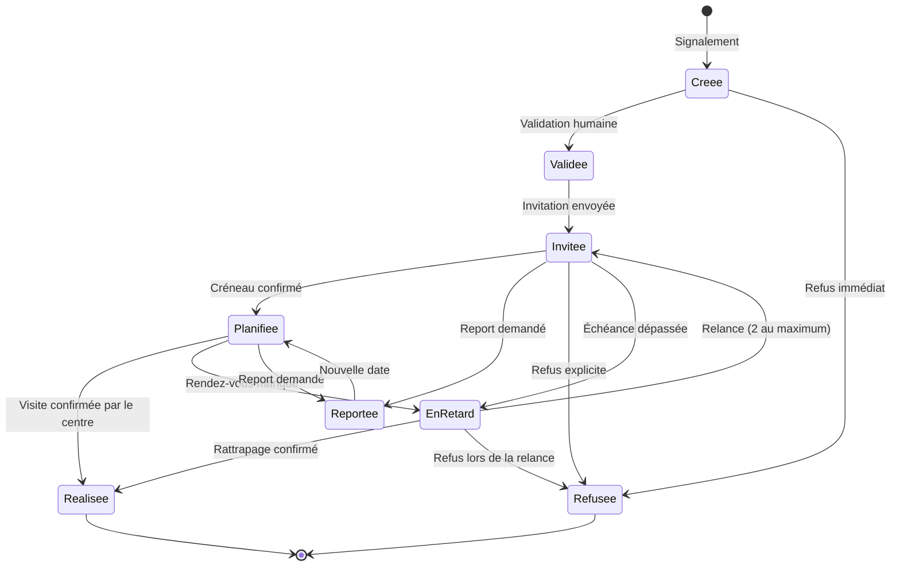
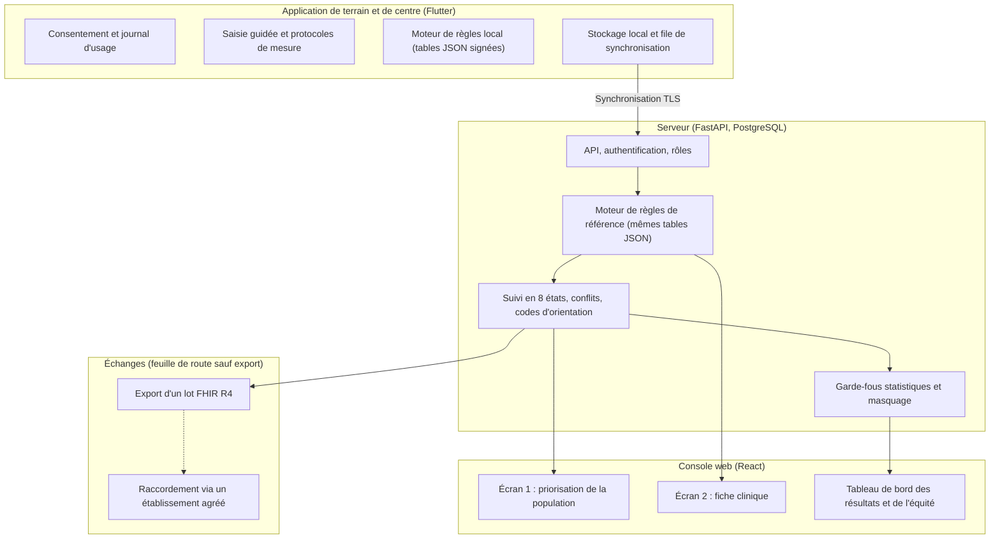

# MediBenin — Cahier des charges

**Prévention et dépistage de précision : enfants, adultes et communautés**

Future Health Digital Innovation Challenge 2026 · Population Health · **Challenge 04 : Precision Prevention and Screening**

| | |
| :--- | :--- |
| **Version** | 7.0, révisée après revue critique « jury » (8 novembre 2026) |
| **Statut** | Document de travail de l'équipe, à relire avant dépôt. Les mentions **[À VÉRIFIER]** renvoient au registre de la section 15.3 |
| **Équipe** | CareX (Université d'Abomey-Calavi : ENEAM, IFRI, FSS) |
| **Livrable du concours** | Prototype fonctionnel au 20 novembre 2026, avec documentation technique, hypothèses et limites |

> [!IMPORTANT]
> **Règle d'écriture de ce document.** Ce que nous savons est écrit comme un fait, avec sa source. Ce que nous supposons est écrit comme une hypothèse (H). Ce qui reste à vérifier porte la mention **[À VÉRIFIER]**. Ce qui est simulé dans le prototype est marqué **[SIMULÉ]**. Le concours demande explicitement les hypothèses et les limites : nous les montrons au lieu de les cacher.

---

## Sommaire

0. [Lecture rapide](#0-lecture-rapide)
1. [Le défi et notre réponse, exigence par exigence](#1-le-défi-et-notre-réponse-exigence-par-exigence)
2. [Périmètre, maturité et statut de chaque brique](#2-périmètre-maturité-et-statut-de-chaque-brique)
3. [Données autorisées, provenance et consentement](#3-données-autorisées-provenance-et-consentement)
4. [Exigence 1 : repérage transparent des risques et des lacunes](#4-exigence-1--repérage-transparent-des-risques-et-des-lacunes)
5. [Exigence 2 : parcours personnalisés, population et clinique séparées](#5-exigence-2--parcours-personnalisés-population-et-clinique-séparées)
6. [Exigence 3 : engagement culturellement adapté et choix réel](#6-exigence-3--engagement-culturellement-adapté-et-choix-réel)
7. [Exigence 4 : garde-fous pour la population locale](#7-exigence-4--garde-fous-pour-la-population-locale)
8. [Exigence 5 : évaluation par les résultats](#8-exigence-5--évaluation-par-les-résultats)
9. [Architecture technique et interopérabilité](#9-architecture-technique-et-interopérabilité)
10. [Cadre réglementaire, éthique, sécurité et licences](#10-cadre-réglementaire-éthique-sécurité-et-licences)
11. [Prototype du 20 novembre 2026](#11-prototype-du-20-novembre-2026)
12. [Équipe et gouvernance clinique](#12-équipe-et-gouvernance-clinique)
13. [Modèle économique et voie vers le pilote](#13-modèle-économique-et-voie-vers-le-pilote)
14. [Matrice des risques](#14-matrice-des-risques)
15. [Hypothèses, limites et registre des vérifications](#15-hypothèses-limites-et-registre-des-vérifications)
16. [Transférabilité aux contextes à ressources limitées](#16-transférabilité-aux-contextes-à-ressources-limitées)
- [Annexes A à E](#annexes)

---

## 0. Lecture rapide

**Le problème (énoncé du défi).** À Abu Dhabi, l'éligibilité et les invitations aux visites de l'enfant (*Well-Child Visits*), au dépistage complet de l'adulte et aux autres parcours de prévention dépendent encore largement de règles d'âge et de sexe. Pourtant, le risque se répartit entre les antécédents familiaux, la génomique, les maladies chroniques, le développement, les comportements, l'historique des visites, la géographie et le contexte social. Les personnes qui en ont le plus besoin sont donc oubliées, invitées trop tard ou orientées vers un parcours inadapté.

**Ce que fait MediBenin, en cinq verbes :**

1. **Repérer** les risques élevés et les soins manqués ou en retard, chez l'enfant, l'adulte et dans les communautés, avec les principaux facteurs de chaque signalement et **son degré de certitude**.
2. **Orienter** vers la bonne visite de l'enfant, le bon dépistage de l'adulte ou la bonne intervention, selon des directives approuvées, avec une échéance.
3. **Engager** chaque personne dans sa langue, sur son canal, avec une information claire et le droit de refuser.
4. **Suivre** chaque recommandation jusqu'à la visite confirmée par le centre de santé.
5. **Mesurer** la portée, les erreurs, l'adoption et les résultats par segment de population, sans jamais publier de petits effectifs ni de chiffres trompeurs.

**Ce que MediBenin n'est pas.** Ce n'est pas un outil de diagnostic, ni un service d'urgence, ni un séquenceur génétique. Il aide des professionnels à décider et à prioriser. Le soignant décide toujours.

**Ce que le jury verra le 20 novembre** (détails en section 11) :
- trois personas synthétiques (un enfant de 18 mois, un adolescent de 14 ans, un adulte de 36 ans) suivis de bout en bout ;
- deux écrans séparés : la liste de priorisation de la population et la fiche clinique individuelle ;
- un badge de certitude sur chaque signalement ;
- une console de population avec masquage des petits effectifs et intervalles de confiance ;
- un banc d'essai synthétique qui compare MediBenin à l'invitation par âge et sexe, à capacité égale, en présentant clairement ce qu'il prouve et ce qu'il ne prouve pas.

---

## 1. Le défi et notre réponse, exigence par exigence

| Exigence officielle | Réponse de MediBenin | Preuve visible au prototype | Sections |
| :--- | :--- | :--- | :---: |
| **1. Transparent risk and care-gap identification** | Règles explicites pour l'enfant (P), l'adulte (A), la génomique (G) et les communautés (C). Chaque signalement indique son type, son niveau, son échéance, ses 1 à 3 facteurs principaux, les données manquantes et un **badge de certitude** | Fiche d'un signalement avec facteurs et badge ; un dossier incomplet passe en Niveau Gris | 4 |
| **2. Personalized preventive pathways** | Parcours unifié par personne (une seule visite quand c'est possible), échéance, rappel et suivi en 8 états. **Deux écrans séparés** : priorisation de la population (score $S_{\text{prio}}$) et fiche clinique (sans ce score) | Les deux écrans ; une recommandation suivie jusqu'à « Réalisée » | 5 |
| **3. Culturally appropriate engagement** | Langue, canal et message adaptés au parent, à l'aidant, à l'adolescent ou à l'adulte. Aides à la décision courtes (bénéfices, limites, et ce qui arrive en cas de refus). Consentement par finalité, report ou refus sans conséquence | Message en arabe et en anglais ; un refus arrête les relances | 6 |
| **4. Local population safeguards** | Portée, faux positifs, faux négatifs, taux de recommandation et adoption par segment de la population d'Abu Dhabi, avec intervalles de Wilson. Masquage des cellules < 10 avec suppression secondaire. Règles communautaires et alertes d'équité | Tableau par segment : une cellule masquée, un résultat « insuffisant » au lieu d'un chiffre | 7 |
| **5. Outcome-based evaluation** | Visites de l'enfant et dépistages de l'adulte réalisés et confirmés, ponctualité, efficacité des rappels, **un critère principal par parcours**, calibrage d'un critère observable, effets indésirables du dépistage | Tableau de bord des résultats sur la cohorte synthétique, avec la comparaison à l'invitation par âge et sexe | 8 |
| **Clause transversale :** *making uncertainty and authorized data use visible* | Badge de certitude individuel, intervalles de confiance pour la population, Niveau Gris, journal d'usage des données consultable par la personne | Badge et journal d'usage à l'écran | 3.3, 4.6, 7 |

---

## 2. Périmètre, maturité et statut de chaque brique

### 2.1 Périmètre

- **Population :** enfants de 0 à 17 ans (via les parents ou aidants, avec l'assentiment de l'adolescent de 12 à 17 ans) et adultes à partir de 18 ans, sans trou d'âge. Communautés repérées à l'échelle des zones.
- **Parcours ciblés à Abu Dhabi :**
  - le programme des visites de l'enfant selon le standard du Department of Health (`DOH/WCV/SD`) **[À VÉRIFIER : version et contenu exacts, V3]** ;
  - le programme de dépistage complet de l'adulte (IFHAS) **[À VÉRIFIER : tranches d'âge, périodicité et contenus, V4]** ;
  - les autres parcours de prévention : vaccination, dépistage des cancers, suivi des maladies chroniques.
- **Hors périmètre :** le diagnostic ; la prise en charge des symptômes aigus (seule existe une règle d'échappement vers les urgences, section 4.5) ; le séquençage et l'interprétation génomique (MediBenin ne lit que des résultats déjà interprétés et autorisés).

### 2.2 Maturité initiale (règle du concours sur les produits existants)

Le projet est né sous le nom **MediBenin**, dans un cadre académique, comme un prototype de triage vocal de symptômes. Ce triage **n'est pas utilisé** pour le défi. Tout ce qui sert au Défi 04 (moteur de prévention, garde-fous, suivi, console) est conçu pendant le défi. Le tableau ci-dessous sera mis à jour le 20 novembre avec l'état réel du dépôt de code.

### 2.3 Statut de chaque brique

| Brique | Statut au 20 novembre | Commentaire |
| :--- | :---: | :--- |
| Moteur de règles P, A, G, C (tables JSON signées) | **Réel** | Exécuté sur les personas et sur la cohorte synthétique |
| Explication des facteurs, badge de certitude, Niveau Gris | **Réel** | |
| Écrans séparés population et clinique, machine à 8 états | **Réel** | |
| Garde-fous statistiques et tableau de bord des résultats | **Réel** | Calculés sur des données synthétiques |
| Cohorte synthétique et banc d'essai | **Réel** | Données **[SIMULÉ]** ; voir section 8.4 |
| Signal génomique | **Simulé** | Ressource FHIR fictive, aucune donnée génomique réelle |
| Échange FHIR R4 (export d'un lot) | **Réel** (export) / **Feuille de route** (raccordement) | Aucun raccordement à Malaffi ni à Sahatna |
| Messages en arabe et en anglais | **Réel** | Relus par des locuteurs natifs **[À VÉRIFIER, V11]** |
| Autres langues (ourdou, hindi, tagalog, malayalam) | **Feuille de route** | Une langue d'Asie du Sud si le temps le permet |
| Fonctionnement hors ligne complet, chiffrement sur l'appareil | **Partiel** | Démonstration hors ligne simple ; chiffrement complet en feuille de route |
| Envoi réel de SMS ou WhatsApp | **Simulé** | File de messages affichée, aucun envoi réel |

---

## 3. Données autorisées, provenance et consentement

### 3.1 Les huit domaines de données de l'énoncé

| Domaine | Variables utilisées | Source cible à Abu Dhabi | Prototype |
| :--- | :--- | :--- | :--- |
| Clinique | Tension artérielle (2 ou 3 mesures), poids, taille, IMC, tour de taille ; HbA1c, lipides, hémoglobine si disponibles ; maladies connues | Dossier de l'établissement, échange Malaffi **[À VÉRIFIER : modalités d'accès, V14]** | Synthétique |
| Génomique | Résultat déjà interprété et autorisé : percentile d'un score polygénique, variant actionnable, résultat du dépistage néonatal | Programme génomique émirati **[À VÉRIFIER : quels résultats sont restitués et sous quelle forme, V5]** | **[SIMULÉ]** |
| Développement | Croissance (scores Z de l'OMS), questionnaires de développement et de dépistage de l'autisme | Visites de l'enfant | Synthétique |
| Comportements | Tabac (cigarette, *medwakh/dokha*, chicha, vapotage), activité physique, alimentation, sommeil | Questionnaire | Synthétique |
| Antécédents familiaux | Maladie cardiovasculaire précoce, diabète, cancers, hypercholestérolémie familiale (1er et 2e degré) | Questionnaire, dossier | Synthétique |
| Visites de l'enfant | Visites faites ou manquées, doses vaccinales | Registre de l'établissement, registre vaccinal | Synthétique |
| Dépistages de l'adulte | Dernier bilan complet, dernier test de dépistage de chaque cancer | Registre de l'établissement | Synthétique |
| Contexte | Région, temps d'accès au centre, langue, canal préféré, préférences (genre du praticien, horaires) | Profil déclaré | Synthétique |

### 3.2 Provenance de chaque variable

Chaque valeur porte un code de provenance, utilisé par le badge de certitude (section 4.6) :

- **V (vérifiée) :** issue d'un dossier ou d'un registre d'établissement ;
- **M (mesurée) :** mesurée lors de l'évaluation selon le protocole ;
- **D (déclarée) :** déclarée par la personne ou l'aidant ;
- **S (simulée) :** donnée de démonstration.

S'y ajoutent la date de la valeur et, pour les mesures, l'identifiant du protocole.

### 3.3 Consentement par finalité et journal d'usage (F1)

- **Cinq autorisations distinctes**, chacune acceptée ou refusée séparément :
  1. évaluation et calendrier de prévention ;
  2. rappels sur le canal choisi ;
  3. transmission du dossier d'orientation au centre de santé ;
  4. statistiques agrégées anonymes ;
  5. utilisation d'un résultat génomique existant.
- **Mineurs :** le consentement vient du parent ou du tuteur légal. Entre 12 et 17 ans, l'assentiment de l'adolescent est recueilli en plus. Les règles de confidentialité propres à l'adolescent sont décrites en section 6.4.
- **Journal d'usage :** la personne peut voir, à tout moment, quelles catégories de données ont été lues, par quelle règle (et sa version), quand, et à qui le dossier a été transmis. C'est la réponse directe à la clause *authorized data use visible*.
- **Retrait :** le retrait d'une autorisation prend effet immédiatement. Le dossier est recalculé sans les données retirées et l'accès aux soins n'est jamais pénalisé.

---

## 4. Exigence 1 : repérage transparent des risques et des lacunes

### 4.1 Typologie

**Quatre types de signalement :** *risque élevé*, *soins manqués*, *soins en retard*, *suivi interrompu*. Les signalements communautaires sont décrits en 4.4.

**Cinq niveaux d'action :**
- **Rouge :** orientation immédiate ;
- **Orange :** visite prioritaire, en général sous 7 à 14 jours ;
- **Jaune :** visite programmée, sous 30 à 90 jours ;
- **Vert :** à jour ;
- **Gris :** données insuffisantes.

Les délais sont des valeurs de départ **(H1)**, à valider par la gouvernance clinique (section 12).

### 4.2 Règles pour l'enfant et l'adolescent (P)

La colonne « Statut » distingue un seuil **publié** dans une référence internationale citée d'une règle **[À VÉRIFIER]** sur un texte d'Abu Dhabi.

| ID | Âge | Condition | Type | Niveau | Référence | Statut |
| :---: | :---: | :--- | :--- | :---: | :--- | :---: |
| P1 | 0–5 ans | Malnutrition aiguë sévère : score Z poids-pour-taille < −3, ou périmètre brachial < 115 mm (6–59 mois), ou œdèmes bilatéraux | Risque élevé | Rouge | OMS, standards de croissance 2006 | Publié |
| P2 | 0–5 ans | Score Z poids-pour-taille ou taille-pour-âge entre −3 et −2 (Orange) ; IMC-pour-âge > +2 (Jaune) ou > +3 (Orange) | Risque élevé | Orange / Jaune | OMS 2006 | Publié |
| P3 | 0–6 ans | Visite de l'enfant manquée : une visite hors de sa fenêtre (Jaune) ; deux visites consécutives (Orange) | Soins manqués / en retard | Jaune / Orange | Standard DoH `DOH/WCV/SD` | [À VÉRIFIER] V3 |
| P4 | 0–17 ans | Dose vaccinale en retard de plus de 30 jours (Jaune) ou de plus de 60 jours (Orange). Enfant « zéro dose » : aucune dose contenant la composante DTC à 14 semaines révolues (Orange) | Soins manqués / en retard | Jaune / Orange | Calendrier national des ÉAU ; définition « zéro dose » de Gavi et de l'OMS | Calendrier [À VÉRIFIER] V3 |
| P5 | 12–24 mois | Dépistage de l'anémie non fait dans la fenêtre prévue (Jaune) ; hémoglobine < 11,0 g/dL (Orange) | Soins manqués / risque élevé | Jaune / Orange | Seuil OMS (6–59 mois) ; fenêtre selon le standard DoH | Fenêtre [À VÉRIFIER] V3 |
| P6 | 16–30 mois | Autisme, M-CHAT-R : score de 3 à 7 → entretien de suivi (*Follow-Up*) ; score ≥ 8, ou entretien de suivi ≥ 2 → orientation | Risque élevé | Jaune → Orange | Grille M-CHAT-R/F publiée | Publié ; licence (section 10.4) |
| P7 | 1–66 mois | Développement : score sous le seuil de référence de l'ASQ-3 dans au moins un domaine (Orange) ; zone de surveillance (Jaune) ; perte d'une compétence acquise à tout âge (Orange) | Risque élevé | Orange / Jaune | Seuils publiés de l'ASQ-3 | Publié ; **licence requise** (10.4) |
| P8 | 5–17 ans | IMC-pour-âge selon la référence OMS 2007 : > +1 (surpoids, Jaune), > +2 (obésité, Orange), < −2 (maigreur, Jaune), < −3 (maigreur sévère, Orange) | Risque élevé | Jaune / Orange | OMS 2007 | Publié |
| P9 | 1–17 ans | Tension artérielle (protocole pédiatrique, 4.7) : avant 13 ans, ≥ 95e percentile pour l'âge, le sexe et la taille ; à partir de 13 ans, ≥ 130/80 (Orange) | Risque élevé | Orange | Recommandation AAP 2017 | Publié |
| P10 | 2–17 ans | Antécédent familial au 1er degré d'hypercholestérolémie familiale ou d'événement cardiovasculaire précoce, sans bilan lipidique (Orange). **C'est la voie d'accélération sans génomique** (7.5) | Risque élevé | Orange | Recommandations internationales sur l'hypercholestérolémie familiale de l'enfant | Publié [À VÉRIFIER : âge du bilan, V6] |
| P11 | 10–17 ans | Vaccins de l'adolescence (HPV, méningocoque, rappels) non faits dans la fenêtre nationale | Soins manqués | Jaune | Calendrier national des ÉAU | [À VÉRIFIER] V3 |

**Questionnaire PHQ-A (santé mentale de l'adolescent).** Il est administré **uniquement par un clinicien**, jamais par un agent hors ligne. Il suit un protocole de sécurité (section 4.5). Au prototype, il n'est que décrit (feuille de route).

### 4.3 Règles pour l'adulte (A)

| ID | Âge | Condition | Type | Niveau | Référence | Statut |
| :---: | :---: | :--- | :--- | :---: | :--- | :---: |
| A1 | ≥ 18 ans | Tension (moyenne des 2e et 3e mesures) : systolique 140–179 ou diastolique 90–109 (Orange) ; systolique 130–139 ou diastolique 85–89 (Jaune) | Risque élevé | Orange / Jaune | OMS HEARTS ; seuil de vigilance (H2) | Publié / H |
| A2 | 40–80 ans | Risque cardiovasculaire à 10 ans, modèle OMS 2019 sans laboratoire (Annexe A) : ≥ 20 % (Orange prioritaire), 10 à < 20 % (Orange), 5 à < 10 % (Jaune) | Risque élevé | Orange / Jaune | OMS 2019 ; HEARTS | Publié ; seuil de 5 % = H3 |
| A3 | ≥ 18 ans | FINDRISC ≥ 15 (Orange), 12 à 14 (Jaune). HbA1c ≥ 6,5 % sans diagnostic connu (Orange), 5,7 à 6,4 % (Jaune). **Aucune imputation par défaut** : les 8 items du questionnaire doivent être renseignés (ou un score déclaré par la personne) ; un item manquant est signalé comme donnée manquante et un questionnaire incomplet ne déclenche jamais la règle sur un score extrapolé | Risque élevé | Orange / Jaune | Lindström et Tuomilehto, 2003 ; seuils HbA1c de l'ADA | Publié |
| A4 | ≥ 18 ans | **Origine d'Asie du Sud ou d'Asie de l'Est et IMC ≥ 23**, sans dépistage glycémique depuis plus de 3 ans → dépistage HbA1c (Jaune). Règle **ajoutée** au FINDRISC sans modifier le score validé | Risque élevé | Jaune | Seuils d'IMC asiatiques de l'OMS (2004) ; recommandation de dépistage de l'ADA | Publié ; adaptation locale H4 |
| A5 | 25–65 ans | Dépistage du cancer du col non fait dans l'intervalle national | Soins manqués / en retard | Jaune | Programme national | [À VÉRIFIER] V4 |
| A6 | 40–69 ans | Mammographie non faite dans l'intervalle national | Soins manqués / en retard | Jaune / Orange | Programme national | [À VÉRIFIER] V4 |
| A7 | 40–75 ans | Dépistage du cancer colorectal (test FIT ou coloscopie) non fait dans l'intervalle national. Antécédent familial au 1er degré : début plus précoce selon les recommandations spécialisées | Soins manqués / risque élevé | Jaune / Orange | Programme national | [À VÉRIFIER] V4 |
| A8 | 18–75 ans | Aucun bilan complet de l'adulte dans l'intervalle du programme | Soins manqués | Jaune | Programme IFHAS | [À VÉRIFIER] V4 |
| A9 | ≥ 18 ans | Maladie chronique connue (hypertension, diabète, maladie cardiovasculaire, maladie rénale chronique) sans visite de suivi depuis plus de 6 mois ; ou personne orientée Orange ou Rouge qui ne s'est pas présentée dans le délai | Suivi interrompu | Orange | OMS PEN ; règle de boucle fermée | Délai = H5 |
| A10 | ≥ 65 ans | Chute dans l'année, trouble de l'équilibre, ou déficit visuel ou auditif non pris en charge | Risque élevé | Jaune / Orange | CDC STEADI (risque de chute) | Publié ; place dans IFHAS [À VÉRIFIER] V4 |
| A11 | Femme, 15–49 ans | **Grossesse en cours** et tension ≥ 140/90 après 20 semaines d'aménorrhée (**Rouge**, suspicion de prééclampsie) ; ≥ 160/110 (**Rouge, le jour même**). Pendant la grossesse, les règles A2 (OMS), A3 (IMC et tour de taille du FINDRISC) et A6 sont suspendues | Risque élevé | Rouge | Recommandations obstétricales internationales sur les troubles hypertensifs de la grossesse | Publié |

### 4.4 Règles communautaires (C)

Ces règles répondent au mot *communities* de l'énoncé. Une communauté est une zone géographique (une municipalité ou un secteur) ou un segment de population (section 7.1).

| ID | Condition (n ≥ 30 dans la zone ou le segment, sinon pas de signalement) | Niveau | Action proposée |
| :---: | :--- | :---: | :--- |
| C1 | **Zone sous-couverte :** la borne haute de l'intervalle de Wilson à 95 % du taux de visites de l'enfant à jour, ou du taux de bilans de l'adulte à jour, est sous la cible du programme (cible = H6) | Orange | Unité mobile, campagne d'invitation ciblée |
| C2 | **Foyer d'enfants zéro dose :** au moins 5 enfants zéro dose repérés dans la zone en 90 jours (affichage soumis au masquage de la section 7.3) | Orange | Rattrapage vaccinal de proximité |
| C3 | **Écart d'adoption :** l'adoption dans un segment est inférieure de plus de 10 points à la moyenne, avec des intervalles de confiance qui ne se chevauchent pas, alors que le taux d'invitation est comparable | Jaune | Revoir la langue, le canal, le créneau, la médiation |
| C4 | **Écart de faux négatifs :** le taux de faux négatifs d'un segment dépasse la moyenne de plus de 5 points, avec au moins 5 événements | Rouge (gouvernance) | Extension bloquée ; revue par la gouvernance clinique |

### 4.5 Règles de sécurité et d'arbitrage

- **Échappement d'urgence (E0).** Si un signe d'urgence est observé pendant l'évaluation (signes de danger de la PCIME chez l'enfant, tension ≥ 180/120 avec symptômes, douleur thoracique, déficit neurologique), le système affiche « orienter immédiatement vers les urgences » et suspend le parcours de prévention. **Ce n'est pas un moteur de triage**, seulement une sortie de sécurité.
- **Protocole PHQ-A (clinicien uniquement).**
  - Item 9 positif (pensées suicidaires) : évaluation de sécurité immédiate par le clinicien, jamais de message SMS, contact avec le circuit d'urgence local **[À VÉRIFIER : numéros et obligations de signalement aux ÉAU, V13]**.
  - Score ≥ 10 : consultation prioritaire.
- **Règle d'éclipse.** Tant qu'un signalement Rouge est actif, les invitations Jaunes des autres parcours sont suspendues. Elles reprennent quand le Rouge est résolu (état 5 ou 8) ou au plus tard après 30 jours, avec revue.
- **Regroupement.** Les signalements Orange et Jaunes d'une même personne sont regroupés dans **une seule visite** quand c'est cliniquement compatible (5.1).
- **Dédoublonnage.** Si une même lacune déclenche deux règles (par exemple P3 et P4 à la même visite), un seul signalement est créé, avec les deux motifs.

### 4.6 Explication et badge de certitude

Chaque signalement affiche les éléments suivants.

1. **Les 1 à 3 facteurs principaux :**
   - **Modèle OMS :** attribution **contrefactuelle**. Pour chaque facteur modifiable (tension, tabac, IMC), on calcule la baisse du risque si ce facteur était ramené à sa valeur cible (par exemple 120 mmHg, non-fumeur, IMC 25). Les facteurs sont classés par baisse décroissante. Cette méthode tient compte des interactions avec l'âge du modèle. L'âge et le sexe sont affichés comme facteurs non modifiables.
   - **FINDRISC :** les items qui apportent le plus de points.
   - **Règles de calendrier :** l'acte manqué, la date attendue et le nombre de jours de retard.
2. **La règle et sa source :** identifiant de la règle, version de la table, référence de la directive.
3. **Les données manquantes.**
4. **Le badge de certitude** (réponse à la clause *making uncertainty visible*) :

| Élément du badge | Calcul |
| :--- | :--- |
| Complétude | Part des variables requises présentes |
| Provenance | Codes V, M, D, S de chaque variable utilisée (3.2) |
| Ancienneté | Âge de la plus ancienne valeur utilisée |
| Validité du domaine | Âge dans le domaine du modèle, pas de grossesse pour A2 et A3, région OMS adaptée à l'origine déclarée (Annexe A) |
| Intervalle de risque (modèle OMS) | Risque recalculé avec la tension à ± 1,96 σ, où σ = 5 mmHg pour la moyenne de deux mesures (H7), et l'IMC à ± 1 kg/m² ; on affiche *risque 12 % [9–16 %]* |

**Niveau de certitude affiché :**
- **Haute :** complétude de 100 %, variables clés V ou M de moins de 12 mois, modèle dans son domaine, et intervalle qui ne franchit aucun seuil de niveau.
- **Moyenne :** une variable clé déclarée ou ancienne, **ou** un intervalle qui franchit un seuil.
- **Faible :** au moins deux variables clés déclarées ou anciennes, **ou** un modèle hors de son domaine. Le signalement est alors présenté comme **« à confirmer »**, avec une action de mesure de confirmation, et non comme une conclusion.

### 4.7 Protocoles de mesure et Niveau Gris (F2, F3)

- **Tension de l'adulte :** 5 minutes de repos, 2 mesures espacées d'au moins 1 minute. Si l'écart dépasse 10 mmHg pour la systolique ou 6 mmHg pour la diastolique, une 3e mesure est demandée et la moyenne des 2e et 3e est retenue (H8 : seuils de la troisième mesure à valider). Les valeurs hors bornes sont refusées : systolique < 60 ou > 260, diastolique < 30 ou > 160, diastolique ≥ systolique.
- **Tension de l'enfant :** brassard adapté au bras ; taille requise pour calculer le percentile (AAP 2017). Sans taille, le signalement passe en Niveau Gris.
- **Croissance :** scores Z calculés par la méthode LMS de l'OMS, sur l'**âge corrigé jusqu'à 24 mois** pour un enfant né avant 37 semaines d'aménorrhée (âge corrigé = âge chronologique − (40 − âge gestationnel à la naissance) semaines). Même règle pour les fenêtres de l'ASQ-3.
- **Niveau Gris :** une donnée manquante n'est **jamais** remplacée par une valeur par défaut. Si les variables requises manquent, le résultat est Gris (« données insuffisantes »), avec la liste des mesures à faire. Un Gris n'est jamais compté comme un Vert.

### 4.8 Signal génomique : une règle de politique, pas une modification du risque (G)

L'estimation du risque (le modèle OMS) **reste celle de l'OMS**. Elle n'est pas modifiée par la génomique et reste donc calibrable. Le signal génomique agit à part, comme une **règle d'éligibilité** :

| ID | Condition (résultat interprété, autorisé par la personne) | Effet |
| :---: | :--- | :--- |
| G1 | Score polygénique coronarien ou diabète au 90e percentile ou plus | Avance le bilan cardiométabolique complet (lipides, HbA1c) ; âge de départ = H9 |
| G2 | Variant actionnable (BRCA1/2, syndrome de Lynch, hypercholestérolémie familiale…) | Orientation vers une consultation spécialisée ou génétique ; calendrier renforcé selon les recommandations spécialisées |
| G3 | Score bas ou résultat négatif | **Aucun effet.** Un résultat génomique ne retarde jamais et ne supprime jamais un dépistage prévu |

Le retrait du consentement génomique supprime le signal G1 sans modifier aucun signalement clinique (A1/A3) — vérifié par TEST-G3.

**Affichage :** « Risque OMS : 7 % [5–9 %] · Signal génomique : percentile 94 **[SIMULÉ]** → bilan avancé (règle G1) ».

**Équité.** Les résultats génomiques concernent surtout les citoyens émiratis **[À VÉRIFIER, V5]**. La voie d'accélération par les antécédents familiaux (P10, A7) existe donc pour tous, et la part des accélérations d'origine génomique est suivie par segment (7.5).

---

## 5. Exigence 2 : parcours personnalisés, population et clinique séparées

### 5.1 Parcours unifié (F5)

Les signalements d'une personne sont assemblés en un **parcours** (`CarePlan`) : actes recommandés, fenêtre de dates, centre cible, rappel et tâche de suivi. Les actes compatibles sont regroupés en une seule visite. Exemple : contrôle de la tension, HbA1c et remise du kit FIT. Chaque acte cite sa règle et sa directive.

### 5.2 Deux écrans, deux responsabilités

| | Écran 1 : priorisation de la population | Écran 2 : fiche clinique individuelle |
| :--- | :--- | :--- |
| **Pour qui** | Coordinateur de programme ou de centre | Médecin ou infirmier, face au patient |
| **Question posée** | Qui inviter en premier, avec la capacité disponible ? | Que recommander à cette personne ? |
| **Contenu** | Liste triée par $S_{\text{prio}}$, capacité restante, files d'attente | Mesures, facteurs, badge de certitude, actes recommandés et directives |
| **Interdit** | Aucune prescription | **$S_{\text{prio}}$ n'est jamais affiché**, pour que la logistique n'influence pas la décision médicale |
| **Actions** | Approuver des invitations (une par une ou par lot) | Valider, adapter selon son jugement (avec un motif), différer (avec un motif) |

### 5.3 Score de priorisation $S_{\text{prio}}$, entièrement défini

$$S_{\text{prio}} = 100 \times \left(0{,}40\, I_{\text{risque}} + 0{,}25\, I_{\text{lacune}} + 0{,}20\, I_{\text{retard}} + 0{,}15\, I_{\text{vuln}}\right)$$

| Composante | Définition |
| :--- | :--- |
| $I_{\text{risque}}$ | Niveau le plus élevé de la personne : Orange = 0,75, Jaune = 0,35, Vert = 0. Les Rouges **ne passent pas par le score** : ils vont dans une file immédiate. Les Gris vont dans une file séparée « compléter les données » |
| $I_{\text{lacune}}$ | $\min(1, \text{nombre de lacunes ouvertes} / 3)$ |
| $I_{\text{retard}}$ | $\min(1, \text{plus grand dépassement d'échéance en jours} / 180)$ |
| $I_{\text{vuln}}$ | Moyenne de trois indicateurs binaires autorisés : temps d'accès au centre > 30 min, langue non couverte ou besoin d'interprète, résidence dans une zone C1. Vaut 0 si l'autorisation « contexte » n'est pas donnée. Ne peut **que** faire monter la priorité |

- **Poids :** valeurs de départ **(H10)**.
- **Analyse de sensibilité, livrée au prototype :** chaque poids varie de ± 0,10, les poids étant renormalisés. On mesure le recouvrement des K premières personnes avec le classement de référence. S'il est inférieur à 80 %, les poids sont signalés comme instables et soumis à la gouvernance clinique.
- **Capacité :** le nombre de créneaux par centre et par jour limite la liste d'invitations proposée.

### 5.4 Suivi en 8 états (boucle fermée)

- **« Réalisée » exige une confirmation** par le centre : une visite enregistrée via le code d'orientation (5.6) ou une validation par le clinicien. Une simple intention reste à l'état « Planifiée ».
- **Au plus 2 relances**, espacées d'au moins 7 jours. Ensuite, pour un Orange, une tâche de contact humain est proposée, si ce canal est autorisé.
- **Un refus arrête immédiatement toutes les relances** de cette recommandation. La personne peut revenir sur sa décision.

### 5.5 Conflits de synchronisation

Quand deux appareils modifient la même recommandation hors ligne :

1. **« Réalisée » confirmée par le centre est définitive.** Seul le centre peut la corriger, et la correction est tracée.
2. **Un refus ou un retrait de consentement** l'emporte sur tout état non final et arrête les relances futures.
3. Pour les autres états, on compare les **dates des événements** (et non les dates de synchronisation). À date égale, l'ordre d'autorité est : centre, puis coordinateur, puis agent.
4. Chaque conflit est journalisé et affiché au coordinateur.

### 5.6 Fermer la boucle sans identité civile

À la création d'une orientation, un **code d'orientation** est généré : 8 caractères ou un QR code. Il est remis à la personne et porté dans la demande d'orientation FHIR (`ServiceRequest.identifier`). Le centre saisit ou scanne ce code lors de la visite, ce qui rattache la visite à l'orientation. Le serveur ne garde qu'une empreinte HMAC du code. Aucun numéro d'identité civile n'est stocké dans la base d'analyse.

---

## 6. Exigence 3 : engagement culturellement adapté et choix réel

### 6.1 Langues et formats

- **Cible à Abu Dhabi :** arabe (standard moderne et dialecte du Golfe pour l'audio), anglais, ourdou, hindi, tagalog et malayalam **[À VÉRIFIER : priorités selon les populations visées par le partenaire, V10]**.
- **Prototype :** arabe et anglais (2.3).
- **Formats :** texte court sans jargon, et **audio enregistré par des locuteurs natifs**. Pas de synthèse ni de reconnaissance vocale libre dans les langues peu dotées. Les réponses se saisissent par boutons et pictogrammes.

### 6.2 Adapter le message au destinataire

| Destinataire | Règle |
| :--- | :--- |
| Enfant de moins de 12 ans | Aucun message direct. Le parent ou l'aidant reçoit l'invitation, avec les documents à apporter |
| Adolescent de 12 à 17 ans | Logistique adressée au parent. Messages sur la santé formulés pour l'adolescent ; confidentialité selon 6.4 |
| Adulte | Message personnel, possibilité d'y associer un proche |
| Aidant d'une personne âgée | Avec l'accord de la personne, regroupement des rappels dans une vue familiale |

### 6.3 Préférences culturelles et pratiques

- Possibilité de demander une **praticienne** pour les examens concernés (mammographie, dépistage du col, examen clinique).
- Pas de messages pendant les heures de prière ni à l'iftar pendant le Ramadan. Les bilans à jeun non urgents sont reprogrammés après le Ramadan ou après l'iftar, selon le souhait de la personne.
- Pour les travailleurs postés et les sites éloignés : créneaux du soir ou du week-end, ou passage d'une unité mobile.
- **Aucun message ne contient de diagnostic, de score ou de mention génétique.** Le détail n'est visible qu'après authentification ou en face à face.

### 6.4 Confidentialité de l'adolescent

- Par défaut, le parent reçoit la logistique (date, lieu).
- Les résultats sensibles (santé mentale, et sujets que la loi locale protège) ne sont visibles **que par le clinicien**. Leur communication au parent suit le droit local **[À VÉRIFIER, V13]**.
- Exception : un danger immédiat (protocole 4.5).

### 6.5 Choix réel : aides à la décision

Chaque invitation à un dépistage s'accompagne d'une **aide à la décision de 3 à 5 phrases**, validée par la gouvernance clinique : pourquoi ce test, comment il se passe, ce qu'il apporte, ses limites (faux positif, examens supplémentaires) et ce qui se passe si l'on refuse. Exemple en Annexe D.

**Trois réponses possibles :** Confirmer, Reporter (en choisissant une date) ou Refuser (sans conséquence sur l'accès aux soins). Chaque message est validé par un humain avant l'envoi : un par un pour les Orange, par lot homogène pour les rappels Jaunes de calendrier.

---

## 7. Exigence 4 : garde-fous pour la population locale

### 7.1 Segments de la population locale (Abu Dhabi)

| Dimension | Modalités |
| :--- | :--- |
| Âge | Les 8 tranches : 0–11 mois, 1–4 ans, 5–9 ans, 10–17 ans, 18–24 ans, 25–39 ans, 40–64 ans, 65 ans et plus |
| Sexe | Femme, homme |
| Groupe de nationalité | Émirati ; résidents par grand groupe d'origine (Asie du Sud, monde arabe hors Émirats, Asie du Sud-Est, autres) **(H11)** |
| Couverture d'assurance | Types de couverture en vigueur à Abu Dhabi **[À VÉRIFIER : catégories exactes, V9]** |
| Région | Abu Dhabi, Al Ain, Al Dhafra |
| Langue préférée | Langues de la section 6.1 |

**Publication hiérarchique.** Pour garder des effectifs suffisants, la console publie d'abord chaque dimension séparément. Elle ne publie ensuite que des croisements de deux dimensions au plus, pris dans une liste fixe : âge × sexe, nationalité × région, langue × programme, assurance × programme.

### 7.2 Indicateurs par segment (F7)

Pour chaque segment $s$ :

- **Portée** = évalués avec un dossier complet / population cible éligible. Les dossiers Gris sont comptés à part.
- **Taux de recommandation** = signalés Jaune, Orange ou Rouge / évalués complets.
- **Adoption** = visites confirmées (état 5) / personnes invitées (état 3).
- **Faux positifs :** taux de faux positifs $\text{TFP} = FP/(FP+VN)$, valeur prédictive positive $\text{VPP} = VP/(VP+FP)$, nombre à inviter pour un cas $\text{NNS} = 1/\text{VPP}$.
- **Faux négatifs :** taux de faux négatifs $\text{TFN} = FN/(FN+VP)$.
  - Dans un pilote, seules les personnes orientées sont vérifiées. Un **échantillon aléatoire de 5 % des Verts** est donc invité à un bilan de référence, et l'estimation est repondérée par l'inverse de la probabilité de vérification (Horvitz-Thompson).
  - **Limite déclarée :** avec peu d'événements, l'intervalle est large. Il est toujours publié avec son intervalle de confiance.
- **Intervalle de Wilson à 95 %** sur chaque proportion :

$$\frac{\hat p + \frac{z^2}{2n} \pm z\sqrt{\frac{\hat p(1-\hat p)}{n} + \frac{z^2}{4n^2}}}{1+\frac{z^2}{n}}, \quad z = 1{,}96$$

### 7.3 Masquage et anti-tromperie

| Situation | Règle | Affichage |
| :--- | :--- | :--- |
| Effectif < 10 | Masquage, plus suppression secondaire de la plus petite cellule voisine de la même ligne et de la même colonne | « Masqué (n < 10) » |
| Effectif de 10 à 29 | Taux affiché avec son intervalle ; aucune comparaison | « Petit effectif : pas de conclusion » |
| Moins de 5 événements | Aucun taux d'erreur publié en pourcentage | « Événements insuffisants » |
| Données manquantes | Niveau Gris ; jamais compté comme Vert | « Données insuffisantes » |

Le masquage est appliqué **dans l'API**, avant tout envoi à l'interface ou tout export.

### 7.4 Alertes d'équité

Ce sont les règles C3 et C4 (4.4), plus une **alerte de portée** : la portée d'un segment est inférieure de plus de 10 points à la moyenne, et les intervalles de confiance ne se chevauchent pas. Une alerte bloque l'extension du déploiement tant qu'elle n'a pas été revue. **On ne la corrige pas en ajustant un seuil** sans l'avis de la gouvernance clinique.

### 7.5 Équité génomique

Indicateur suivi : la part des accélérations d'éligibilité d'origine génomique (G1, G2), et celle d'origine familiale (P10, A7), par groupe de nationalité. Un écart est attendu (H12) ; il doit rester visible et être compensé par la voie familiale.

---

## 8. Exigence 5 : évaluation par les résultats

### 8.1 Indicateurs demandés par l'énoncé (F8)

| Indicateur de l'énoncé | Définition |
| :--- | :--- |
| Visites de l'enfant réalisées | Lacunes de visite comblées et confirmées / lacunes signalées |
| Dépistages complets de l'adulte réalisés | Bilans complets confirmés / adultes orientés |
| Actions de prévention réalisées | Actes confirmés / actes recommandés. Exemples : dose rattrapée, FIT rendu, mammographie faite, dépistage de l'anémie, M-CHAT, bilan lipidique |
| Ponctualité | Part des visites faites dans le délai du niveau ; délai médian et intervalle interquartile entre le signalement et la visite |
| Rappels et suivi | Conversion selon le rang du rappel (1re invitation, relance 1, relance 2, contact humain) ; part des recommandations « en retard » ramenées à « réalisée » ; **taux de boucles fermées** = (réalisées + refus éclairés) / recommandations émises |
| Calibrage du modèle | Voir 8.3 |
| Valeur clinique en aval | Voir 8.2 |

### 8.2 Un critère principal par parcours

| Parcours | Critère principal | Critères secondaires |
| :--- | :--- | :--- |
| Visites de l'enfant | Part des lacunes comblées dans leur fenêtre | Doses rattrapées, enfants zéro dose rattrapés, dépistages de l'autisme et de l'anémie faits |
| Dépistage de l'adulte | **Rendement** : conditions nouvellement confirmées (hypertension, diabète, prédiabète, dyslipidémie) pour 100 invitations | Bilans complets réalisés, délai |
| Cancers | Dépistages en retard réalisés | Suivi après un FIT positif (coloscopie faite) |
| Suivi interrompu | Part des personnes revues dans les 30 jours | Maladie contrôlée à la visite suivante (pilote) |

**Effets indésirables suivis :** signalements négatifs à la confirmation, coloscopies normales après un FIT positif, nombre de messages par personne, taux de désinscription.

**Comparaison.** Chaque critère est comparé à la règle d'invitation par âge et sexe, **à capacité égale** (K invitations).

### 8.3 Calibrage : ce qui est calibrable, et quand

- Seul le **modèle OMS** produit une probabilité. Les lacunes de soins sont des règles et le FINDRISC est un score.
- Un risque à 10 ans **ne peut pas être calibré dans un pilote de quelques mois**.
- **Dans le pilote**, nous calibrons un critère observable : la **probabilité qu'une condition soit confirmée à la visite de confirmation**, estimée à partir des données du signalement. On mesure le score de Brier, l'erreur de calibrage attendue (ECE) par quintiles, et l'intercept et la pente de recalibrage, par segment quand l'effectif le permet.
- **Dans le prototype**, les courbes de calibrage sont calculées sur la cohorte synthétique. Elles montrent que la chaîne de calcul fonctionne et qu'elle **détecte un mauvais calibrage** quand les données sont mal spécifiées (8.4). Elles ne mesurent pas la performance clinique.

### 8.4 Banc d'essai synthétique (prototype)

| Élément | Choix |
| :--- | :--- |
| Taille | 50 000 personnes de 0 à 85 ans ; 20 graines aléatoires ; tous les résultats avec leur variabilité entre graines |
| Structure de la population | Inspirée de statistiques publiques d'Abu Dhabi **[À VÉRIFIER : sources, V12]** (H13) |
| Vérité cachée | États de santé tirés de **prévalences publiées et d'une fonction de risque différente de celles du moteur** (documentée dans le dépôt), pour limiter la circularité |
| Observations | Bruit de mesure ; données manquantes au hasard (10 %) |
| Scénarios de mauvaise spécification | (a) données manquantes plus fréquentes chez les personnes à risque ; (b) sous-déclaration du tabac et des antécédents ; (c) historique de visites incomplet |
| Comparaison | MediBenin contre l'invitation par âge et sexe, à capacité K égale, sur les critères de 8.2 |
| Ce que le banc d'essai prouve | Que la chaîne fonctionne, que les garde-fous se déclenchent et que le comportement résiste aux scénarios (a) à (c) |
| Ce qu'il ne prouve pas | **Aucune efficacité clinique.** Aucun chiffre de performance n'est annoncé avant l'exécution du banc d'essai |

### 8.5 Protocole du pilote (après le concours)

- Pilote encadré dans un établissement partenaire, après autorisations. Mesure du **taux de base avant intervention**, puis comparaison avant et après, ou par grappes si le partenaire l'accepte.
- Critères de passage à l'échelle **fixés avant le pilote** : portée par segment, taux de faux négatifs, taux de visites confirmées, écarts d'équité, délai de traitement des Orange.
- **Ces critères ne sont pas modifiés** une fois les résultats connus.

---

## 9. Architecture technique et interopérabilité

### 9.1 Vue d'ensemble

### 9.2 Une seule source de vérité pour les règles

Les règles P, A, C et G, les seuils, les fenêtres et les tables pré-calculées (paramètres LMS de l'OMS, tables du modèle OMS 2019) sont stockés dans des **fichiers JSON versionnés et signés**. Chaque règle porte sa source, sa version, sa date et son statut. L'application et le serveur lisent **les mêmes fichiers**. Le moteur Python sert de référence aux tests, qui comparent les sorties sur des profils communs. Une table non signée est refusée.

Les **seuils numériques** vivent dans six documents JSON versionnés (`who-cvd`, `diabetes-screening`, `blood-pressure`, `pediatric`, `adult-screening`, `privacy`), chacun portant son `schemaVersion`, sa version, sa date d'effet et sa citation de source. Un chargeur unique les valide au démarrage et calcule un **hash SHA-256** par document : toute modification de valeur passe par une nouvelle version du document, jamais par une retouche de code. Les documents déployés sont auditables en continu via `GET /api/governance/thresholds`.

**Contrôle d'accès par rôle et scoping par propriété.** Chaque route API est soumise à une matrice de rôles **refus par défaut**. Les rôles personnels (patient, parent) n'accèdent qu'à leurs **dossiers liés** et aux membres de la famille qui y sont affiliés ; les rôles professionnels (clinicien, coordinateur) opèrent au périmètre de l'établissement (référence H) ; la santé publique n'a **aucun** accès à un dossier individuel — agrégats de l'observatoire uniquement. Cette matrice est vérifiée par TEST-G1, et les seuils versionnés par TEST-G2.

### 9.3 Correspondance FHIR R4 (export)

| Concept | Ressource FHIR | Codage |
| :--- | :--- | :--- |
| Personne | `Patient` | Identifiant pseudonyme, sexe, année de naissance, langue |
| Lien parent-enfant, antécédents | `RelatedPerson`, `FamilyMemberHistory` | |
| Consentement par finalité | `Consent` | Les 5 finalités de 3.3 |
| Mesures | `Observation` | LOINC : panel de tension 85354-9, systolique 8480-6, diastolique 8462-4, poids 29463-7, taille 8302-2, IMC 39156-5, tour de taille 8280-0, HbA1c 4548-4, hémoglobine 718-7, tabac 72166-2 ; **autres codes [À VÉRIFIER sur loinc.org, V15]** (périmètre brachial, FINDRISC, M-CHAT, PHQ-A) |
| Vaccin | `Immunization` | |
| Signal génomique | `Observation` **[SIMULÉ]** | Selon le guide HL7 *Genomics Reporting* |
| Signalement | `RiskAssessment` / `DetectedIssue` | Niveau, facteurs, badge, règle et version |
| Parcours, orientation, suivi | `CarePlan`, `ServiceRequest` (avec code d'orientation), `Task`, `Appointment`, `Encounter` | Les 8 états de 5.4 |

**Interopérabilité.** L'export suit FHIR R4 de base. La conformité aux guides d'implémentation de Malaffi n'est **pas** revendiquée : elle sera établie avec un établissement agréé **[V14]**.

### 9.4 Exigences non fonctionnelles

Ce sont des **cibles**, mesurées et publiées au prototype :
- évaluation complète en moins de 1 seconde sur un téléphone Android d'entrée de gamme ;
- fonctionnement de l'évaluation sans réseau ;
- synchronisation sans doublon ;
- accessibilité visée WCAG 2.1 AA, avec affichage de droite à gauche pour l'arabe.

### 9.5 Dépôt de code (le concours peut le demander)

- README avec une procédure reproductible ;
- génération de la cohorte à partir d'une graine ;
- tests unitaires de chaque règle ;
- tests d'acceptation (11.3) ;
- licence ;
- aucun secret ni aucune donnée réelle dans le dépôt.

---

## 10. Cadre réglementaire, éthique, sécurité et licences

### 10.1 Qualification

MediBenin est **conçu comme un outil d'aide à la décision** pour des professionnels :
- il applique des directives publiées ;
- il montre la règle derrière chaque résultat ;
- il n'analyse aucun signal ni aucune image ;
- le soignant décide.

Un logiciel qui priorise des personnes selon leur risque peut cependant être qualifié de dispositif médical par certains régulateurs. **La qualification sera confirmée auprès du DoH avant tout usage réel [V13].**

### 10.2 Textes applicables à Abu Dhabi

| Texte | Ce que nous en retenons | Statut |
| :--- | :--- | :---: |
| Loi fédérale n° 2 de 2019 sur les TIC dans le domaine de la santé | Données de santé hébergées aux Émirats ; confidentialité | Cité ; lecture juridique [V13] |
| Décret-loi fédéral n° 45 de 2021 (PDPL) | À notre connaissance, il **exclut** les données de santé régies par leur propre législation ; son application à MediBenin est à confirmer | [À VÉRIFIER] V13 |
| Politiques du DoH sur l'IA en santé (politique de 2018, norme d'IA responsable citée dans notre v4.1) | Gouvernance, analyse d'impact, piste d'audit des décisions | [À VÉRIFIER] V13 |
| Norme de sécurité ADHICS | Contrôles de sécurité ; présentés comme un prérequis au raccordement à Malaffi | [À VÉRIFIER] V14 |
| Règlement du concours (FAQ Hack2Skill) | La propriété intellectuelle reste à l'équipe ; produit existant possible si sa maturité est déclarée ; données légales, personnelles réduites au nécessaire ; code partageable | Lu |

### 10.3 Sécurité

- Chiffrement TLS en transit.
- Base de données chiffrée côté serveur ; chiffrement sur l'appareil en feuille de route (2.3).
- Accès par rôle : l'agent voit sa tournée ; le coordinateur voit des données agrégées et masquées ; le clinicien voit ses patients.
- Journal d'accès non modifiable.
- Révocation à distance d'un appareil.

### 10.4 Licences des instruments

| Instrument | Condition d'utilisation | Décision pour le prototype |
| :--- | :--- | :--- |
| ASQ-3 | Protégé (Brookes Publishing). L'utilisation électronique demande une licence | **Pas d'items ASQ-3 dans le prototype.** La règle P7 est démontrée avec un score fictif ; demande de licence ou instrument libre de remplacement **[V7]** |
| M-CHAT-R/F | Gratuit pour l'usage clinique ; une intégration logicielle demande une autorisation des auteurs | Demande d'autorisation **[V7]** ; d'ici là, items non reproduits |
| PHQ-9 / PHQ-A | Utilisation libre | Clinicien uniquement (4.5) |
| FINDRISC | Grille publiée | À confirmer [V7] |
| Modèles OMS 2019 | Publication en accès ouvert | Cités et implémentés |
| LOINC | Licence gratuite de Regenstrief | Mention de la licence |

---

## 11. Prototype du 20 novembre 2026

### 11.1 Périmètre (MoSCoW, profil Abu Dhabi uniquement)

| Priorité | Contenu |
| :--- | :--- |
| **Indispensable** | Moteur de règles et tables JSON signées ; 3 personas ; explications, badge de certitude, Niveau Gris ; deux écrans séparés ; machine à 8 états avec codes d'orientation ; console avec masquage et intervalles de Wilson ; banc d'essai synthétique avec critères par parcours ; tableau Réel / Simulé à jour |
| **Souhaitable** | Messages et aides à la décision en arabe et en anglais (audio) ; consentement par finalité et journal d'usage ; export FHIR R4 ; analyse de sensibilité de $S_{\text{prio}}$ |
| **Facultatif** | Démonstration hors ligne ; une langue d'Asie du Sud ; carte par région (un tableau suffit sinon) |
| **Hors prototype** | Raccordement réel à Malaffi ou Sahatna ; envoi réel de SMS ; chiffrement complet sur l'appareil ; autres profils de pays |

### 11.2 Démonstration (environ 8 minutes)

1. **Consentement et journal d'usage** (1 min) : une famille accepte certaines finalités et en refuse d'autres ; le journal montre ce qui a été lu.
2. **Persona 1, enfant de 18 mois** (1 min 30) : visite des 18 mois manquée (P3), dépistage de l'anémie non fait (P5), M-CHAT-R à 5 (P6 : entretien de suivi). Les facteurs, la certitude (carnet vérifié ou déclaratif) et un parcours unique sont affichés.
3. **Persona 2, adolescent de 14 ans** (1 min) : IMC-pour-âge à +2,3 (P8), vaccin de l'adolescence non fait (P11), antécédent familial d'hypercholestérolémie familiale (P10). Montre qu'il n'y a pas de trou entre 6 et 17 ans.
4. **Persona 3, adulte de 36 ans, originaire d'Asie du Sud** (2 min) :
   - tension à 136/88 (A1 Jaune) ;
   - FINDRISC à 15 (A3 Orange) ;
   - IMC à 24 (A4) ;
   - signal génomique **[SIMULÉ]** au 94e percentile (G1) ;
   - le modèle OMS s'affiche « hors domaine (< 40 ans) », la certitude est moyenne (tabac déclaré) ;
   - passage de l'écran 1 à l'écran 2 : $S_{\text{prio}}$ disparaît.
5. **Engagement et choix** (1 min) : message et aide à la décision en arabe ; un refus arrête les relances ; un rendez-vous suivi jusqu'à « Réalisée » via le code d'orientation.
6. **Garde-fous et résultats** (1 min 30) : tableau par segment avec une cellule masquée et une cellule « petit effectif » ; alerte C3 ; critères par parcours comparés à l'invitation par âge et sexe ; scénario de mauvaise spécification ; rappel de ce que le banc d'essai ne prouve pas.

### 11.3 Tests d'acceptation

| Test | Vérification |
| :--- | :--- |
| TEST-E1 | Un profil complet produit le bon signalement, avec ses 1 à 3 facteurs, sa règle et son badge. Un profil incomplet produit un Niveau Gris |
| TEST-E2 | Aucun champ `priority_score` n'est présent dans l'API ni dans l'interface de la fiche clinique. Un parcours unique regroupe les actes compatibles |
| TEST-E3 | Un refus ou un retrait de consentement arrête toute relance en moins d'une seconde. Les messages ne contiennent aucun terme clinique de la liste d'exclusion |
| TEST-E4 | Un segment de 7 personnes est masqué, ainsi que sa cellule complémentaire, dans l'API et dans l'export |
| TEST-E5 | Une visite « Planifiée » ne compte pas comme réalisée tant que le code d'orientation n'a pas été saisi par le centre |
| TEST-E6 | L'observatoire est calculé depuis la cohorte du banc d'essai : sommes de segments exactes, cellules masquées valides, alertes typées (C1/C3/C4) et critères comparés à l'invitation par âge et sexe |
| TEST-G1 | La matrice de rôles refuse par défaut : chaque route n'est accessible qu'aux rôles autorisés, un rôle personnel ne voit que ses dossiers liés et affiliés, la santé publique n'a aucun accès individuel |
| TEST-G2 | Les seuils cliniques proviennent des documents JSON versionnés (v1.0.0, hash SHA-256 re-vérifié) ; aucun seuil n'est calculé ni tuné dans le code |
| TEST-G3 | Le retrait du consentement génomique supprime le signal G1 sans jamais retarder les signalements cliniques (A1/A3) |
| TEST-S1 | Conflit « Reportée » (agent hors ligne) contre « Réalisée » (centre) : le résultat est « Réalisée » et le conflit est journalisé |
| TEST-S2 | Un Rouge actif suspend les invitations Jaunes (éclipse) |
| TEST-S3 | Grossesse et tension à 150/95 : Rouge (A11) ; A2 et A3 suspendues |
| TEST-S4 | Enfant né à 32 semaines d'aménorrhée : les scores Z sont calculés sur l'âge corrigé |
| TEST-S5 | Une table de règles non signée est refusée |

### 11.4 Plan et points de contrôle

| Date | Jalon | Responsable |
| :--- | :--- | :--- |
| 9–11 nov. | Tables JSON (règles, LMS, OMS) ; moteur ; personas | Orace A. (application), Bienderan E. (référence Python) |
| **12 nov.** | **Contrôle 1 :** règles relues par la gouvernance clinique ; les personas passent | Sydney K. et conseiller clinique |
| 12–14 nov. | Écrans 1 et 2, 8 états, codes d'orientation ; générateur de cohorte | Orace A., Bienderan E. |
| **15 nov.** | **Contrôle 2 :** démonstration de bout en bout, même sans finition | Toute l'équipe |
| 15–17 nov. | Garde-fous, banc d'essai, messages et audio, finition, tests | Bienderan E., Freud B., Uriel K. |
| **18 nov.** | **Gel du code ;** tous les tests de 11.3 passent | Toute l'équipe |
| 19 nov. | Vidéo, README, mise à jour des tableaux 2.3 et 15.3 | Uriel K., Freud B. |
| 20 nov. | Dépôt | Orace A. |

Si le contrôle 2 n'est pas atteint, tout ce qui est « Souhaitable » est retiré du périmètre.

---

## 12. Équipe et gouvernance clinique

| Membre | Rôle | Établissement |
| :--- | :--- | :--- |
| Orace ATTINMAWASSONOU | Développement principal et IA, coordination | ENEAM, UAC |
| Bienderan EGBO | Backend, données, statistiques, cohorte synthétique | ENEAM, UAC |
| Uriel KPEGBE | Sécurité, confidentialité, documentation | IFRI, UAC |
| Freud BOKOSSA | IA, langues, évaluation et équité | IFRI, UAC |
| Sydney KPEGBE | Référent médical : règles, calendriers, contenus | FSS, UAC — **statut à préciser (étudiant ou médecin diplômé), H14** |

**Gouvernance clinique.**
- Toute table de règles est relue par le référent médical et **signée par un clinicien diplômé** (médecine de famille ou pédiatrie), à désigner **(H14)**.
- Chaque règle porte une date de revue. Une règle reconnue erronée est retirée par une nouvelle version signée, et le retrait est tracé.

**Partenaire.** Nous recherchons un établissement agréé à Abu Dhabi, avec l'appui du programme du défi, pour le pilote et pour le raccordement **[V14]**.

---

## 13. Modèle économique et voie vers le pilote

> [!NOTE]
> Aucun prix n'a été discuté avec un acheteur. Cette section présente **la logique de valeur et les hypothèses à tester**. Elle n'annonce pas de rentabilité.

### 13.1 Qui achète, et quoi

| Acheteur type (Abu Dhabi) | Ce qu'il achète | Indicateur qui l'intéresse |
| :--- | :--- | :--- |
| Programme public de prévention | Couverture et équité des programmes de visites de l'enfant et de dépistage de l'adulte | Portée par segment, lacunes comblées, zones C1 résorbées |
| Réseau de soins primaires | Remplissage utile des créneaux, moins de rendez-vous manqués | Taux de visites confirmées, ponctualité |
| Assureur | Dépistages réalisés chez ses assurés à risque | Rendement par invitation, suivi des maladies chroniques |
| Employeur de grands sites | Santé des travailleurs, accès facilité | Bilans réalisés sur site |

### 13.2 Ce qui nous distingue

Les règles cliniques sont publiques et peuvent être copiées. La valeur de MediBenin tient ailleurs, au **dernier kilomètre** :
- la boucle fermée jusqu'à la visite confirmée ;
- l'engagement multilingue avec un choix réel ;
- les garde-fous d'équité et d'incertitude intégrés ;
- la fonction d'orchestration, qui se branche sur les dossiers existants sans les remplacer.

### 13.3 Modèles de prix à tester (H15)

- Par personne couverte et par an.
- Par lacune comblée et confirmée (paiement au résultat).
- Par établissement, avec un forfait d'intégration.

Le choix se fera au pilote, avec le partenaire.

### 13.4 Coûts : ce que nous savons et ce qui reste à chiffrer

| Poste | Statut |
| :--- | :--- |
| Développement du prototype et d'un premier produit minimal | Estimation interne : 28 000 USD (H16) |
| Infrastructure par évaluation (calcul et messages) | Estimation interne : environ 0,04 USD par évaluation, hors hébergement souverain (H16) |
| Hébergement aux Émirats, audit de sécurité, conformité | **À chiffrer avec le partenaire.** Ces postes seront probablement nettement plus élevés que dans nos versions précédentes |
| Licences des instruments (ASQ-3, etc.) | À chiffrer [V7] |
| Équipe et conseiller clinique | À chiffrer selon le financement du pilote |
| Temps des soignants (validation, confirmation) | Mesuré au pilote. La validation par lot des Jaunes vise à le réduire |

### 13.5 Voie vers le pilote

1. Accord d'un établissement partenaire et de l'autorité compétente.
2. Autorisations : comité d'éthique, qualification réglementaire, conformité de l'hébergement.
3. **Budget du pilote demandé**, établi avec le partenaire : équipe, hébergement, licences, temps de confirmation des visites, traduction et enregistrements audio.
4. Protocole de la section 8.5, avec des critères fixés à l'avance.
5. Décision de passage à l'échelle sur ces critères.

---

## 14. Matrice des risques

| Risque | Gravité | Réponse | Responsable |
| :--- | :---: | :--- | :--- |
| Une personne à risque est rassurée à tort (faux négatif) | Critique | Niveau Gris ; badge « à confirmer » ; contrôle de 5 % des Verts ; alerte C4 | Gouvernance clinique |
| Saturation des centres | Élevée | Capacité intégrée à $S_{\text{prio}}$ ; les Rouges dans une file séparée ; validation par lot | Bienderan E. |
| Banc d'essai jugé circulaire | Élevée | Générateur distinct, scénarios de mauvaise spécification, limites écrites (8.4) | Bienderan E., Freud B. |
| Erreur de transcription d'un seuil | Critique | Une seule source JSON signée ; tests par règle ; relecture clinique | Orace A., Sydney K. |
| Affirmation réglementaire ou clinique inexacte | Élevée | Registre 15.3 ; rien n'est affirmé sans source | Uriel K. |
| Licence d'un instrument non obtenue | Moyenne | Items non reproduits ; instrument de remplacement | Uriel K. |
| Retard du prototype | Élevée | Périmètre MoSCoW ; points de contrôle des 12 et 15 novembre | Orace A. |
| Iniquité d'accès (langue, nationalité, génomique) | Élevée | Segments locaux, alertes d'équité, voie familiale | Freud B. |
| Ré-identification dans la console | Élevée | Masquage dans l'API, suppression secondaire | Uriel K. |
| Fatigue des soignants face aux validations | Moyenne | Lots homogènes pour les Jaunes ; revue une par une des Orange seulement | Gouvernance clinique |

---

## 15. Hypothèses, limites et registre des vérifications

### 15.1 Hypothèses (H)

| N° | Hypothèse |
| :---: | :--- |
| H1 | Délais par niveau (Orange 7 à 14 jours, Jaune 30 à 90 jours) |
| H2 | Seuil de vigilance tensionnelle à 130/85 (Jaune) |
| H3 | Seuil de 5 % pour le Jaune du modèle OMS |
| H4 | Règle « origine asiatique et IMC ≥ 23 » ajoutée au FINDRISC |
| H5 | Délai de 6 mois pour le suivi interrompu |
| H6 | Cibles de couverture des règles C1 |
| H7 | σ = 5 mmHg pour la tension moyenne (intervalle de risque) |
| H8 | Seuils de 10 et 6 mmHg pour la troisième mesure de tension |
| H9 | Âge de départ du bilan avancé par la génomique (G1) |
| H10 | Poids de $S_{\text{prio}}$ |
| H11 | Regroupement des nationalités en grands groupes |
| H12 | Écart d'accès à la génomique selon la nationalité |
| H13 | Structure démographique de la cohorte synthétique |
| H14 | Statut du référent médical ; désignation d'un clinicien signataire |
| H15 | Modèles de prix |
| H16 | Estimations internes de coûts |

### 15.2 Limites

- **Aucune performance clinique n'est démontrée.** Le prototype repose sur des données synthétiques ; il valide la chaîne de traitement et les garde-fous.
- **Le modèle OMS est limité aux 40–80 ans.** En dessous, seules les règles de tension, de FINDRISC, d'antécédents et de génomique s'appliquent.
- **Le choix de la région OMS est imparfait pour les résidents d'autres origines.** Il est signalé dans le badge de certitude.
- **La génomique est simulée.** Sa disponibilité réelle et son équité restent à établir.
- **Les indicateurs de résultats dépendent de la confirmation des visites par les centres.**
- **L'estimation des faux négatifs repose sur un échantillon de contrôle de faible puissance.**
- **Aucun raccordement réel** à Malaffi, à Sahatna ou au registre vaccinal.

### 15.3 Registre des vérifications (V)

| N° | Point à vérifier | Section | Responsable | Échéance | Si non vérifié |
| :---: | :--- | :---: | :--- | :--- | :--- |
| V3 | Standard DoH des visites de l'enfant (version, visites, contenus, fenêtres) et calendrier vaccinal national | 4.2, Annexe C | Sydney K. | 12 nov. | Règles P3, P4, P5, P11 marquées « à vérifier » dans l'application |
| V4 | Programme IFHAS (tranches, périodicité, contenus) et intervalles nationaux de dépistage des cancers | 4.3 | Sydney K. | 12 nov. | Règles A5 à A8 et A10 marquées « à vérifier » |
| V5 | Résultats génomiques restitués par le programme émirati, forme, population couverte | 3.1, 4.8 | Uriel K. | Avant le dépôt | Le signal reste explicitement simulé |
| V6 | Âge du bilan lipidique de l'enfant en cas d'hypercholestérolémie familiale | 4.2 | Sydney K. | 12 nov. | Valeur de départ annoncée |
| V7 | Licences : ASQ-3, M-CHAT-R/F, FINDRISC | 10.4 | Uriel K. | 14 nov. | Items non reproduits |
| V9 | Catégories de couverture d'assurance à Abu Dhabi | 7.1 | Freud B. | 14 nov. | Dimension retirée |
| V10 | Langues prioritaires selon le partenaire | 6.1 | Freud B. | Pilote | Arabe et anglais seulement |
| V11 | Relecture des messages par des locuteurs natifs extérieurs à l'équipe | 6 | Freud B. | 17 nov. | Messages marqués « non relus » |
| V12 | Sources démographiques publiques d'Abu Dhabi | 8.4 | Bienderan E. | 13 nov. | Structure déclarée comme hypothétique |
| V13 | Qualification réglementaire, PDPL, politiques IA du DoH, confidentialité de l'adolescent, protocole d'urgence | 4.5, 6.4, 10 | Uriel K. | Avant le pilote | Aucun usage réel |
| V14 | Accès à Malaffi, ADHICS, établissement partenaire | 9.3, 10.2, 12 | Orace A. | Après le concours | Export FHIR seulement |
| V15 | Codes LOINC non confirmés | 9.3 | Bienderan E. | 14 nov. | Codes locaux temporaires |

---

## 16. Transférabilité aux contextes à ressources limitées

MediBenin est né à l'Université d'Abomey-Calavi, au Bénin. Les choix qui rendent l'outil utile aux populations les moins bien servies d'Abu Dhabi le rendent aussi transférable aux systèmes à ressources limitées : saisie guidée par l'audio, Niveau Gris quand les analyses manquent, modèles sans laboratoire, synchronisation différée, profils de règles par pays. Un profil Bénin (calendrier national, région OMS « Afrique subsaharienne de l'Ouest ») est envisagé **après** le concours. Il ne fait pas partie du prototype et **n'a pas été testé sur le terrain**.

---

## Annexes

### Annexe A. Modèle OMS 2019 sans laboratoire

- **Source :** WHO CVD Risk Chart Working Group, *Lancet Global Health*, 2019 : modèles recalibrés pour 21 régions du monde.
- **Implémentation de référence :** calculateur ou paquet publié **[nom et version à consigner, V15]**. Les coefficients sont chargés depuis la source, jamais retapés.
- **Résultat :** risque à 10 ans d'infarctus ou d'AVC, mortel ou non.
- **Variables :** âge, sexe, tabagisme actuel, tension systolique (moyenne des mesures retenues), IMC.
- **Domaine :** 40 à 80 ans, en dehors de la grossesse.
- **Région :** « North Africa and Middle East » par défaut à Abu Dhabi. Si l'origine est déclarée et autorisée, la région d'origine peut être proposée (par exemple « South Asia »), et le badge indique que le choix de région est incertain (H11).
- **Affichage :** risque OMS avec son intervalle (4.6) ; facteurs contrefactuels ; **aucune modification du risque par la génomique** (4.8).
- **Test d'acceptation :** au moins 50 profils de référence, en concordance avec l'implémentation publiée.

### Annexe B. FINDRISC (Lindström et Tuomilehto, *Diabetes Care*, 2003)

| Item | Réponse : points |
| :--- | :--- |
| Âge | < 45 ans : 0 · 45–54 : 2 · 55–64 : 3 · > 64 : 4 |
| IMC | < 25 : 0 · 25–30 : 1 · > 30 : 3 |
| Tour de taille | Homme : < 94 cm : 0 · 94–102 : 3 · > 102 : 4 ; Femme : < 80 cm : 0 · 80–88 : 3 · > 88 : 4 |
| Activité physique ≥ 30 min/jour | Oui : 0 · Non : 2 |
| Fruits ou légumes chaque jour | Oui : 0 · Non : 1 |
| Traitement antihypertenseur | Non : 0 · Oui : 2 |
| Glycémie élevée déjà constatée | Non : 0 · Oui : 5 |
| Diabète dans la famille | Non : 0 · 2e degré : 3 · 1er degré : 5 |

Total de 0 à 26. MediBenin : 15 ou plus = Orange ; 12 à 14 = Jaune. Grille suspendue pendant la grossesse. Pour les personnes d'origine asiatique, la règle A4 **s'ajoute** au score ; elle ne le modifie pas.

### Annexe C. Calendriers de l'enfant (profil Abu Dhabi)

- **Visites de l'enfant selon le standard DoH `DOH/WCV/SD`** **[À VÉRIFIER, V3]** : nouveau-né, 1, 2, 4, 6, 9, 12, 15 et 18 mois, 2 ans, 2 ans et demi, 3, 4, 5 et 6 ans. Contenu de chaque visite (croissance, développement, dépistage de l'autisme, de l'anémie, de la vision et de l'audition, vaccins) à recopier depuis le texte officiel, avec la référence de page.
- **Calendrier vaccinal national des ÉAU :** à recopier depuis la source officielle, avec sa date **[V3]**. Les règles P4 et P11 lisent cette table ; elles ne codent aucun vaccin en dur.
- **De 6 à 17 ans :** suivi de la croissance selon la référence OMS 2007, de la tension (AAP 2017), de la vision et de l'audition, et des vaccins de l'adolescence, selon les textes nationaux de santé scolaire et adolescente **[V3]**.

### Annexe D. Textes types

**Consentement (adulte) :**
> « Bonjour. Je travaille avec le centre de santé de [lieu]. Avec votre accord, nous allons faire un point de prévention d'environ 8 minutes. Vous pouvez accepter certaines choses et en refuser d'autres : l'évaluation, les rappels sur votre téléphone, l'envoi de votre dossier au centre, les statistiques anonymes, l'utilisation d'un résultat génétique que vous avez déjà. Refuser ne change rien à votre accès aux soins, et vous pouvez changer d'avis plus tard. Qu'acceptez-vous ? »

**Consentement (parent ou aidant) :** même trame, avec : « Les informations de votre enfant ne sont transmises qu'au centre de santé. » L'adolescent de 12 à 17 ans donne aussi son accord.

**Exemple d'aide à la décision (dépistage colorectal par FIT) :**
> « Ce test cherche des traces de sang invisibles dans les selles. Il se fait chez vous, en quelques minutes. Il aide à trouver tôt des lésions qui se soignent mieux à un stade précoce. Un test positif ne veut pas dire cancer : la plupart du temps, l'examen de contrôle est normal, mais il est nécessaire. Vous pouvez refuser ou demander à en parler avec un soignant. »

**Message d'invitation :**
> « Bonjour. Une visite de prévention est proposée pour [vous / votre enfant] le [date] au centre de [lieu]. Répondez 1 pour confirmer, 2 pour choisir une autre date, 3 si vous ne souhaitez pas participer. »

Aucun message ne contient de diagnostic, de score ni de mention génétique. Tous les textes sont relus par des locuteurs natifs **[V11]** et validés par la gouvernance clinique.

### Annexe E. Sources de données et droits d'utilisation

| Source | Propriétaire | Usage dans le projet | Données personnelles réelles |
| :--- | :--- | :--- | :---: |
| Modèles OMS 2019 sans laboratoire | OMS, *Lancet Global Health* | Implémentation citée | Non |
| Standards de croissance OMS (2006) et référence 2007 | OMS | Tables LMS | Non |
| FINDRISC | Lindström et Tuomilehto | Grille citée [V7] | Non |
| M-CHAT-R/F, ASQ-3 | Auteurs et éditeurs | Logique de règle seulement ; items non reproduits sans autorisation [V7] | Non |
| Recommandations AAP 2017 sur la tension de l'enfant, OMS HEARTS, CDC STEADI | Organismes cités | Seuils cités | Non |
| Textes du DoH et de l'ADPHC (visites de l'enfant, IFHAS) | Autorités d'Abu Dhabi | Calendriers, après vérification [V3, V4] | Non |
| Cohorte synthétique MediBenin | Équipe CareX | Banc d'essai et démonstration | **Non (100 % synthétique)** |
| Signal génomique de démonstration | Équipe CareX | Ressource FHIR fictive | **Non** |