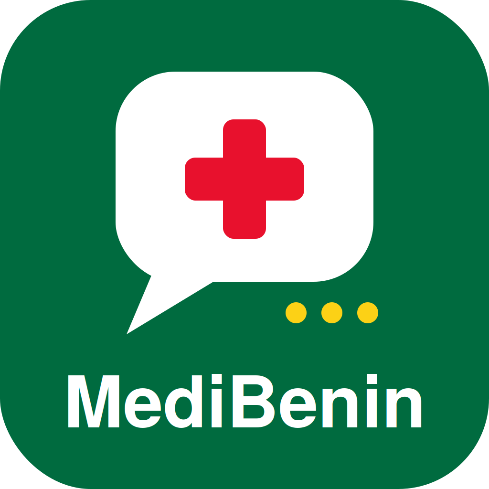

<p align="center">
  
</p>

<h1 align="center">MediBenin 🇧🇯🩺</h1>

<p align="center">
  <strong>Plateforme multimodale de triage clinique, d'orientation d'urgence et de santé des populations.</strong><br>
  <em>Développé par l'équipe <strong>CareX</strong> (Orace ATTINMAWASSONOU, Bienderan EGBO, Uriel KPEGBE & l'équipe).</em>
</p>

<p align="center">
  <a href="https://github.com/orace229/medibenin"></a>
  
  
  
</p>

---

## 📌 Présentation du Projet
En Afrique subsaharienne et particulièrement au Bénin, l'accès aux soins de santé primaires se heurte à des barrières critiques : déserts médicaux ruraux, ratios soignants/habitants faibles, barrière linguistique et analphabétisme, et retards fatals dans la reconnaissance des signes de danger vitaux pédiatriques.

**MediBenin** est une solution de santé numérique hybride conçue pour répondre à ces défis en combinant :
1. **L'inclusivité linguistique & vocale** : Interaction vocale bidirectionnelle en langues locales béninoises (**Fongbe, Yoruba, Bariba**) et en français, s'appuyant sur des modèles de transcription et de synthèse adaptés aux langues africaines.
2. **La rigueur clinique déterministe** : Intégration stricte des protocoles **PCIME** (Prise en Charge Intégrée des Maladies de l'Enfant 0–5 ans de l'OMS / Ministère de la Santé du Bénin) et **TETU** (Triage des Enfants en Traitement d'Urgence), complétés par une IA d'orientation clinique explicable (XAI).
3. **La santé des populations tout au long de la vie** : Passage des soins purement réactifs à la prévention prédictive (suivi vaccinal PEV, dépistage précoce de la malnutrition via MUAC, orientation pour les hémoglobinopathies/drépanocytose et risques cardiométaboliques).
4. **La souveraineté et la protection des données** : Pseudonymisation stricte et conformité réglementaire avec l'**APDP Bénin** (Loi n°2017-20 portant protection des données à caractère personnel).

---

## 🏗️ Architecture du Répertoire

```text
medibenin/
├── frontend/             # Application Web responsive (React 18, Vite, TypeScript, Tailwind CSS)
│   ├── src/
│   │   ├── components/  # Composants cliniques (Triage, Vocal, Urgences, Annuaire, Téléconsultation, Audit)
│   │   └── App.tsx      # Point d'entrée de l'interface
│   └── package.json
│
├── flutter_mobile/       # Application Mobile multiplateforme (Flutter / Dart)
│   ├── lib/             # 22 écrans cliniques, gestion d'état et navigation
│   └── pubspec.yaml
│
├── core/                 # Moteur d'inférence clinique & triage en Python
│   ├── triage_matrix.py     # Matrice déterministe PCIME / TETU (Vert, Orange, Rouge)
│   └── symptom_analyzer.py  # Analyseur NLP et extracteur de red flags vitaux
│
├── models/               # Modèles de données de santé (Pydantic / Enums)
│   ├── domain_models.py     # Schémas Patient, TriageResult, Facility, Audit
│   └── enums.py             # Langues locales, niveaux de gravité, types d'établissements
│
├── tests/                # Suite de tests unitaires et validation des protocoles
│   ├── test_triage_matrix.py
│   └── test_symptom_analyzer.py
│
└── docs/                 # Spécifications et documentation d'architecture
    ├── architecture_diagram.md  # Architecture 3-tiers & passerelle DHIS2
    └── uml_modeling.md          # Diagrammes de cas d'utilisation, classes et séquences
```

---

## 🚀 Démarrage Rapide

### 1. Application Web (Frontend)
Nécessite Node.js (>= 18) :
```bash
cd frontend
npm install
npm run dev
```
L'application est accessible localement sur `http://localhost:5173`.

### 2. Moteur de Triage & Tests Cliniques (Python)
Nécessite Python (>= 3.10) :
```bash
# Exécution des tests de conformité clinique PCIME
python -m unittest discover tests
```

### 3. Application Mobile (Flutter)
Nécessite Flutter SDK :
```bash
cd flutter_mobile
flutter pub get
flutter run
```

---

## 🔒 Éthique, Sécurité & Gouvernance
- **Protection des données** : Aucun enregistrement de donnée nominative sans consentement exprès. Conforme aux directives de l'Autorité de Protection des Données Personnelles du Bénin (**APDP**).
- **Gouvernance clinique** : 100 % des cas critiques identifiés comme **ROUGE** et les cas à incertitude clinique élevée sont acheminés vers le portail d'audit collégial du **Comité Médical**.
- **Avertissement médical** : MediBenin est un outil d'orientation et d'aide à la décision qui ne remplace pas un avis médical posé par un praticien habilité.

---

## 👥 Équipe CareX (5 Membres)
- **Orace ATTINMAWASSONOU**
- **Bienderan EGBO**
- **Uriel KPEGBE**
- *(+ 2 membres de l'équipe CareX)*

*Projet soumis dans le cadre du **Future Health Challenge** (MBZUAI / Microsoft / Inception 42) — Axe 02 : Santé des populations.*
