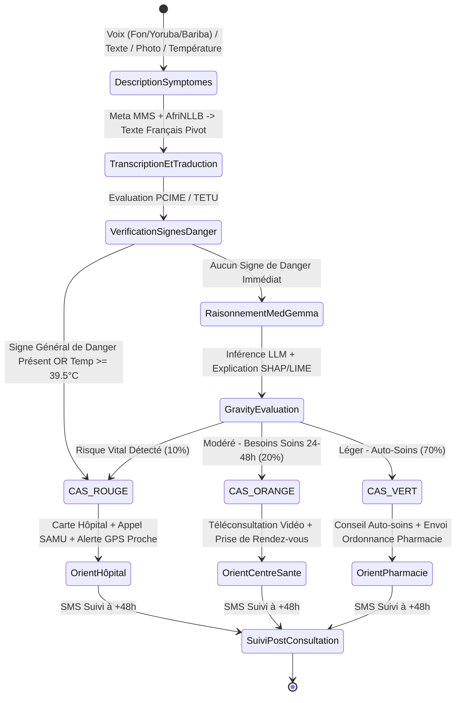
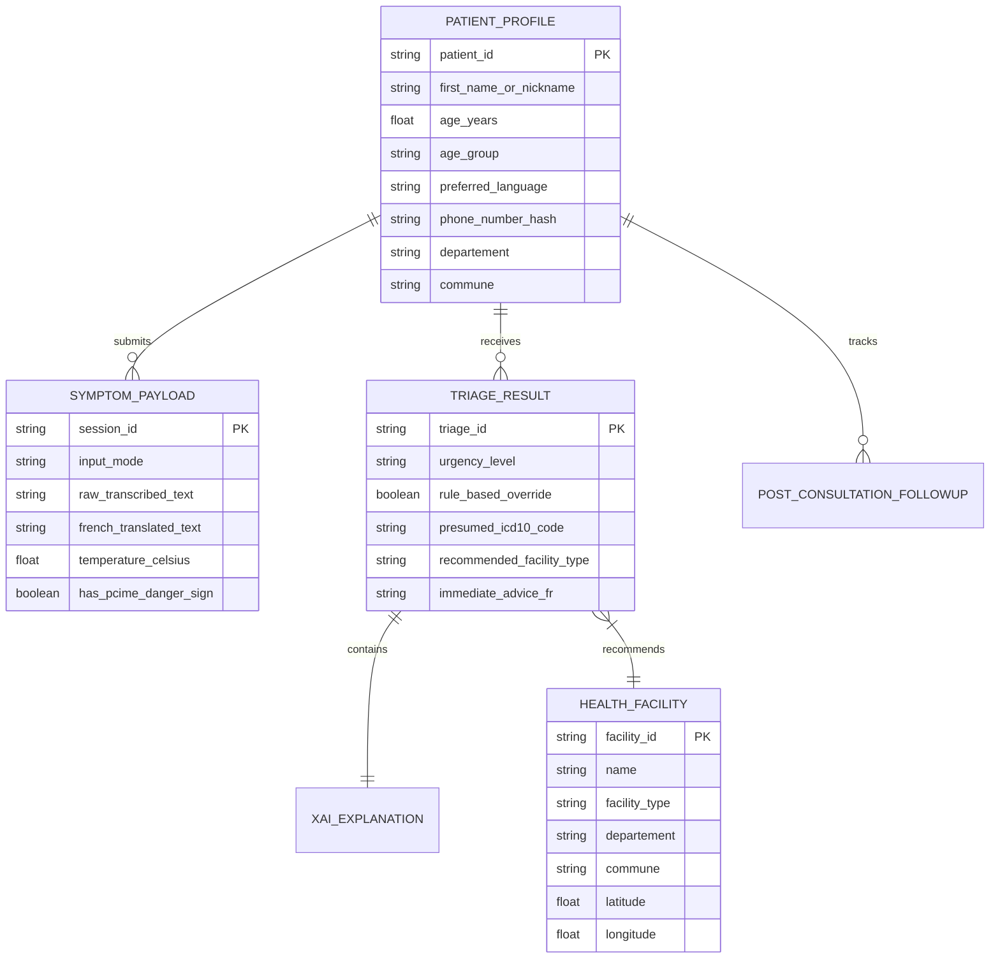

# Architecture et Diagrammes de Modélisation MediBenin

Ce document rassemble les diagrammes d'architecture, de données et de workflow pour la plateforme **MediBenin** (CareX).

---

## 1. Vue d'Ensemble des Composants Système (Architecture 3-Tiers & Microservices)

```mermaid
graph TD
    subgraph Client Layer (Flutter Cross-Platform)
        AppMobile[Application Mobile Flutter - Android Prioritaire]
        AppWeb[Application Web / PWA Flutter]
    end

    subgraph Core Backend Layer (Django / PostgreSQL)
        DjangoAPI[Core API Django REST Framework]
        DB[(Base de données PostgreSQL + JSONB)]
        FirebaseAuth[Firebase Auth - SMS OTP]
    end

    subgraph AI Microservice Layer (Python FastAPI)
        FastAPI[Microservice Inférence IA]
        MetaMMS[Meta MMS - ASR ASR/TTS Fon/Yoruba/Bariba]
        AfriNLLB[AfriNLLB - Traduction Pivot vers FR]
        MedGemma[MedGemma 4B/27B - Raisonnement Clinique]
        RulesEngine[Moteur de Règles Déterministe PCIME / TETU]
        XAI[Calculateur Explicabilité SHAP / LIME]
    end

    subgraph External Integrations Layer
        SMSGateway[Passerelle SMS - Twilio / Celcom]
        MobileMoney[APIs Mobile Money - MTN / Moov FCFA]
        DHIS2[API National Santé DHIS2]
    end

    AppMobile -->|HTTPS / REST| DjangoAPI
    AppWeb -->|HTTPS / REST| DjangoAPI
    AppMobile -->|Auth SMS| FirebaseAuth
    
    DjangoAPI -->|Read/Write| DB
    DjangoAPI -->|Inférence Async/Sync| FastAPI

    FastAPI --> MetaMMS
    MetaMMS --> AfriNLLB
    AfriNLLB --> RulesEngine
    RulesEngine -->|Si Signe Danger| TriageRouge[Urgence Vitale Imposée]
    RulesEngine -->|Si Aucun Danger| MedGemma
    MedGemma --> XAI

    DjangoAPI -->|Suivi + Rappels| SMSGateway
    DjangoAPI -->|Paiement Téléconsultation| MobileMoney
    DjangoAPI -->|Données Épidémiologiques Anonymisées| DHIS2
```

---

## 2. Diagramme d'État & Workflow de Triage Clinique



---

## 3. Schéma Conceptuel des Données (MCD / Entités Pydantic & ORM)


