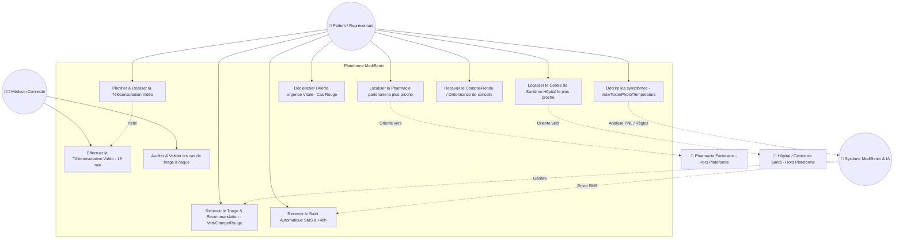
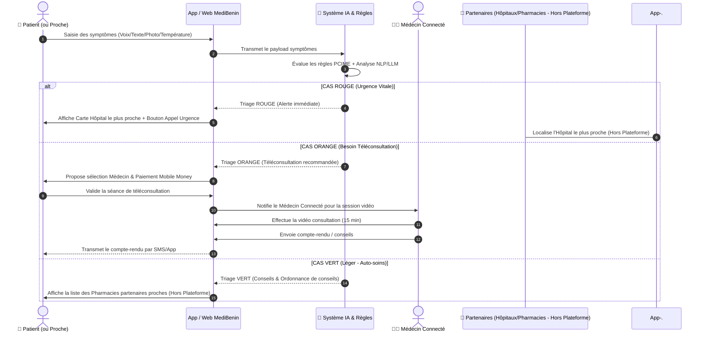
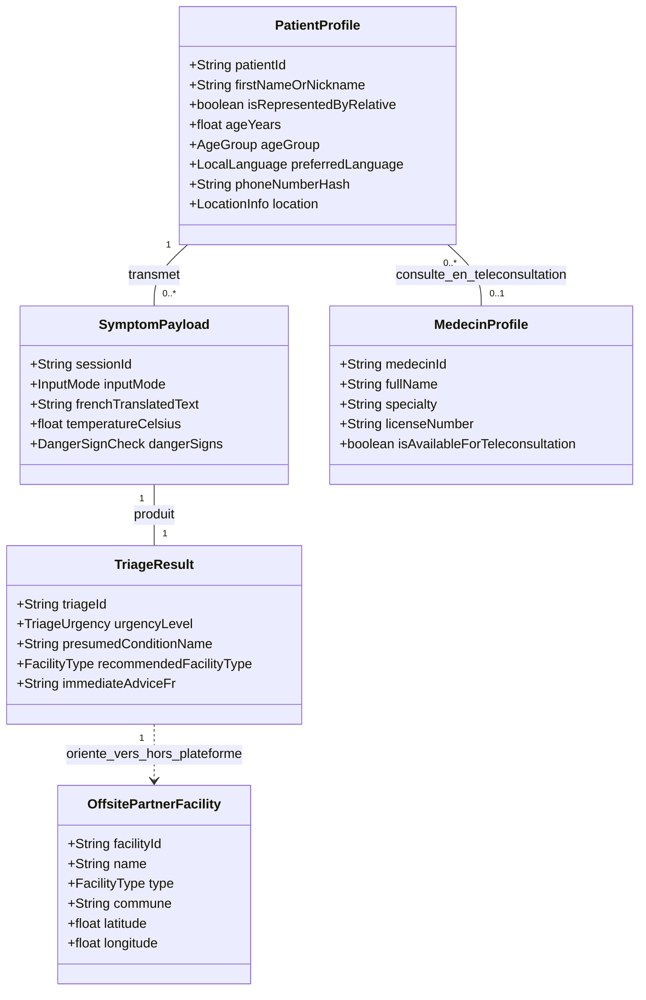

# Modélisation UML Ajustée - Plateforme MediBenin (CareX)

Ce document rassemble les **diagrammes UML révisés** selon les spécifications précises des acteurs retenus pour **MediBenin** :
- **Patient** : Représente le patient direct ET le proche/parent qui saisit les informations pour lui.
- **Médecin** : Acteur connecté actif de la plateforme (téléconsultation vidéo, audit/validation).
- **Pharmacie & Centres de Soins** : Partenaires hors plateforme (référencés pour l'orientation et la cartographie, mais sans compte/connexion requis).
- **Système / Microservice IA** : Acteur système automatisé (triage, transcription MMS, traduction AfriNLLB, MedGemma, règles PCIME).

---

## 1. Diagramme de Cas d'Utilisation (Use Case Diagram Ajusté)

---

## 2. Diagramme de Séquence : Parcours Simplifié Patient - Système - Médecin

---

## 3. Diagramme de Classes Révisé (Modèle Simplifié)

